# Polymarket Research & Trading Workspace

A self-hosted workspace for exploring prediction markets, researching opportunities,
following your portfolio, and managing trading strategies from one place. Connect a
wallet, choose how much automation you want, and use the research agents to turn a
question into a clear, reviewable analysis.

## User guide

This guide covers the application’s public pages, signed-in workspace, strategy
screens, analytics, settings and administrator tools. Start the self-hosted
workspace using [How to use the project](#how-to-use-the-project), then follow the
workflow you need below. Navigation groups are under **More** on desktop and the
navigation menu on smaller screens; administrator entries require an admin account.

All screenshots are captured from the running application with synthetic demo
accounts, markets and API responses. Research/simulation examples use the disposable
real-API fixture app; the wider screen examples use controlled browser API fixtures.
Displayed balances, prices and example results are illustrations, not live account
statements or demonstrated returns. Empty charts show where a fresh workspace has
no observations; they are not populated with invented trading history.

Live trading features are enabled by default through the durable execution gateway.
Real orders require server strategy switches, global administrator activation, wallet activation and
risk budgets. Simulation and replay never grant live authority. Legacy direct
signers remain blocked. See the [live execution setup](#live-execution-setup)
for the supported paths and remaining limits.

| Goal | Start here | Access or prerequisite |
| --- | --- | --- |
| Browse and save markets | [Markets and manual orders](#markets-watchlists-and-manual-orders) | Browsing is public; trading requires a session |
| Research a market | [Opportunities and research](#opportunities-and-market-research) | AI generation needs a configured provider |
| Ask questions or run a plan | [AI and orchestration](#ask-the-ai-and-orchestration) | Sign in and configure an AI provider |
| Find traders and forecasters | [Leaderboard and collaboration](#leaderboard-trader-research-and-collaboration) | Public board; sign in to follow or contribute |
| Follow or simulate a trader | [Copy trading](#copy-trading-and-follower-simulation) | Sign in; simulation/capture flags as described below |
| Review holdings and exits | [Positions and trade history](#positions-trade-history-and-protection) | Signed-in account |
| Configure a strategy | [Market making](#market-making), [backtesting](#backtesting), [latency arbitrage](#latency-arbitrage) | Signed-in account; capabilities depend on deployment/plan |
| Monitor information | [News and whales](#news-and-whale-monitoring), [venues](#cross-venue-signals) | Sign in; optional feeds need server configuration |
| Review performance | [Risk, execution and calibration](#risk-execution-and-forecast-analytics) | Sign in; metrics require eligible recorded data |
| Configure your workspace | [Accounts and settings](#accounts-settings-and-integrations) | Sign in; billing/provider features depend on configuration |
| Inspect operations | [Operations and administration](#operations-and-administration) | Ops requires sign-in; diagnostics/admin settings require admin |

### Sign in and find your way

1. Open **Login** or choose a sign-in action on a public page.
2. Choose your browser wallet or, when configured, WalletConnect, then approve
   the login signature.
   The signature creates an application session; it is separate from depositing
   funds, submitting an order or connecting a trading key.
3. After login, use the account selector when multiple accounts are available.
   Check the account and execution-mode badge before working with account data.
4. Use the top navigation, **More**, or the mobile navigation menu to open a page.
   Use **Logout** when finished. The app’s **Your Guide** page also offers a tour.


### Dashboard and notifications

Open **Dashboard** for balances, position counts, invested/current value, P&L,
positions, market discovery and the followed-trader feed. Review the execution-mode
badge; where allowed, **Switch to Paper** changes the account setting. Paper
balances/counters and live portfolio values represent different records.

Filter the following feed by trader or event type, and use **Refresh** to fetch
new observations. The bell opens the notification center; read an item, follow its
link, or mark notifications read. Notifications can include followed-trader
activity, redemption reminders and operational warnings. Configure delivery
channels separately in **Settings → Notifications**.

Risk-operation actions include rescoring, arbitrage scanning and opening the full
Ops Center. Treat these as monitoring/research operations; check their reported
result rather than assuming a completed trade or a flat portfolio.


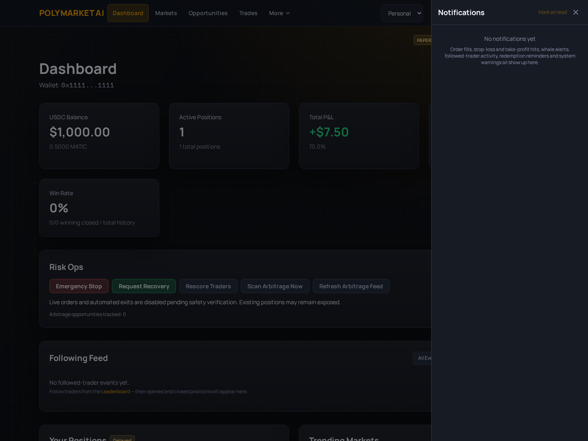

### Markets, watchlists and manual orders

Open **Markets** to browse events and outcomes. Use category buttons, search,
**Sort markets**, pagination/loading controls and the watchlist view to narrow the
board. Expand **Open market details** to inspect a grouped event. A market
watchlist is local browser research state; it does not buy an outcome or subscribe
a trading strategy.

To inspect order entry, choose a market’s YES/NO trade action. In the trade ticket,
check the market and outcome, BUY/SELL side, amount units, indicated price, quote
age and any size suggestion. A buy budget in USDC differs from a sell amount in
shares. Review the confirmation and any rejection; an indicative quote is not
proof of executable depth. Keyboard presets and suggestions do not submit an order
by themselves. Current live-order restrictions still apply.


### Opportunities and market research

Open **Opportunities** for a market scan and its filters. Expand a market and
choose **Research market**. **AI Analysis** is the separate legacy analysis flow;
its link-supplied inputs are not a substitute for source-backed context.

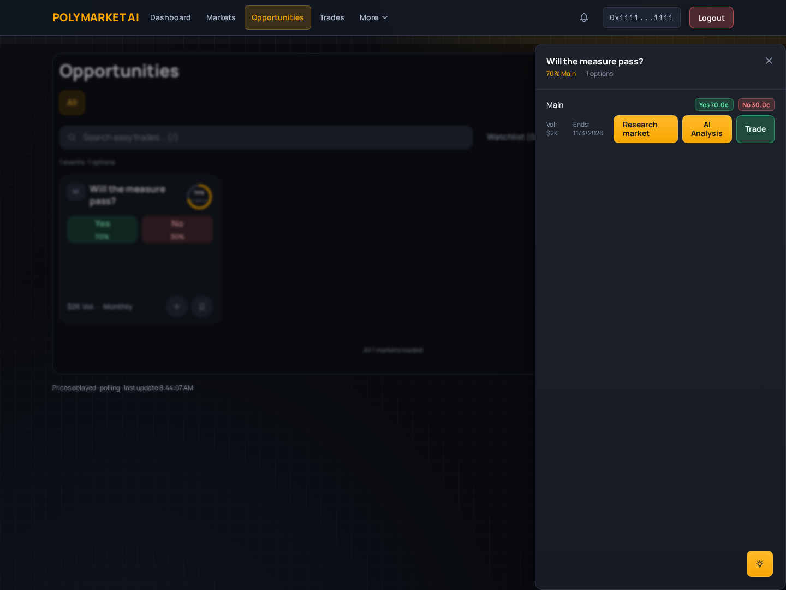

In the research view, check the question, outcome identities, source retrieval
clock and **What determines the outcome?**. Follow **Review original market
source** to inspect the venue. Expand **Source identity** to see the condition ID,
rule/token-mapping hash and captured snapshot identity. Missing prices and rules
remain unavailable. End-date metadata does not independently verify a settlement
cutoff or oracle, and token prices do not establish order-book depth.

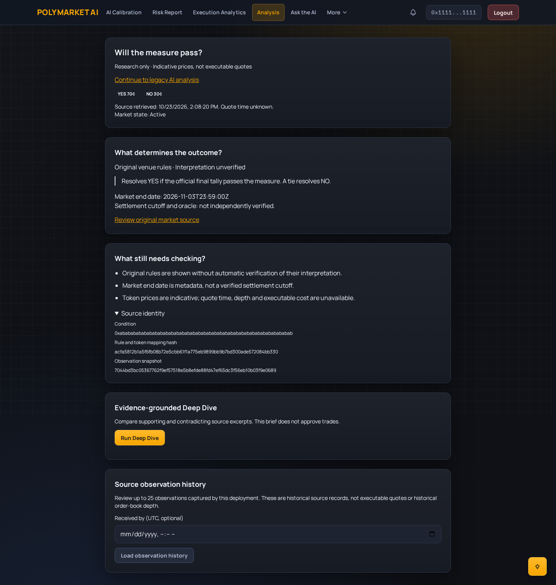

Choose **Run Deep Dive** to request a structured evidence brief. Review supporting
and contradicting claims, source links, missing information and limits. A matched
quotation establishes attribution to captured text, not truth or entailment.
**Investigate further** is a research status; **Insufficient evidence** means the
inputs or output do not support a usable brief. Cancel an in-progress request or
use the retry action after a failure. AI provider access must be configured.

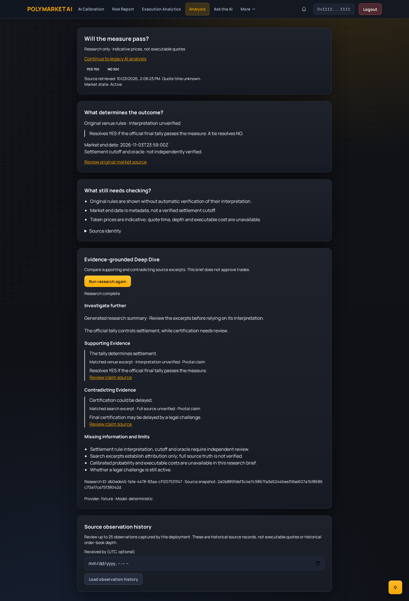

Under **Source observation history**, choose **Load observation history**. Set
**Received by (UTC, optional)** to inspect only observations captured by that time,
and expand an observation to compare original rules and hashes. Later revisions
do not overwrite earlier captures. History starts with this deployment’s captures;
it does not backfill order books or store private AI briefs.


### Ask the AI and orchestration

Open **Ask the AI**, choose **Open palette**, or use **Ctrl/Cmd+K**. Enter a question,
use an example or a recent question, then choose **Ask**. Voice input depends on
browser support and microphone permission. Watch the plan steps and synthesis;
partial/error states must not be mistaken for a completed answer. **Escape** closes
the palette. Suggested action links lead to review pages; they do not approve or
place orders.


For an explicit plan, open **Orchestrator**:

1. Choose **Market Deep Dive**, **Opportunity Sweep**, or **Trader Diligence**.
2. Fill the displayed payload: market details, a JSON market list, or trader and
   proposed-position inputs, depending on the plan. Verify numbers and identities.
3. Start the plan, inspect each completed step and read the synthesis. Cancel or
   retry as needed; keep provider failures and incomplete steps visible.

The Orchestrator’s legacy research/risk/trade-plan workflow is distinct from the
source-attributed structured Deep Dive above. Generated plans remain review material.

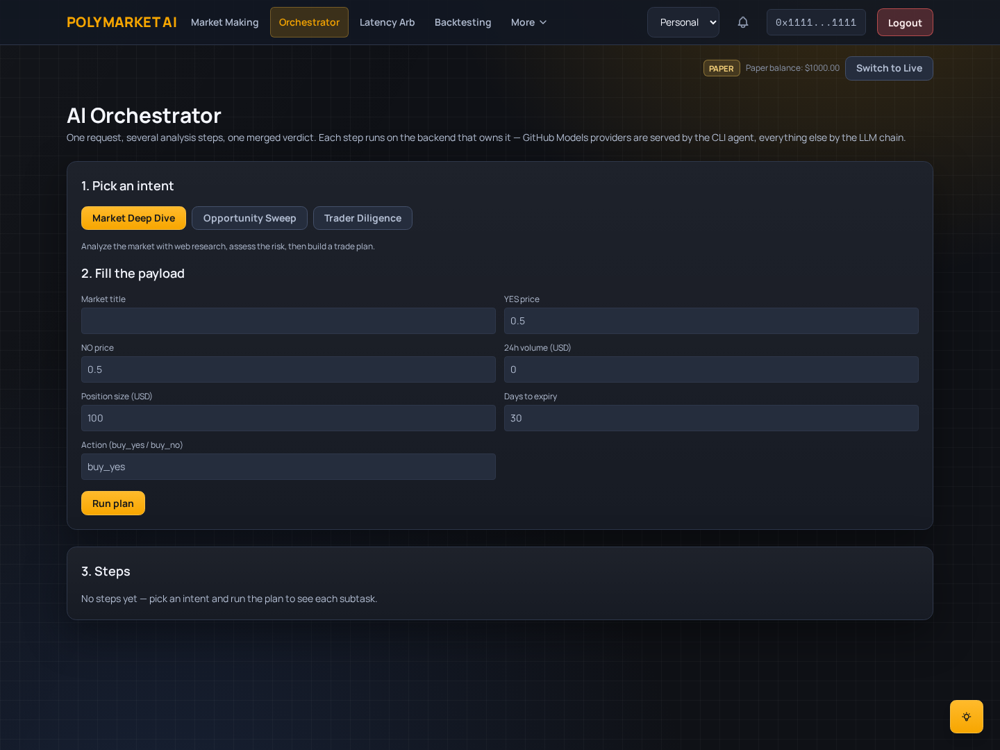

### Leaderboard, trader research and collaboration

Open **Leaderboard** and choose the trading or **Forecasting accuracy** view.
Filter the board’s period/scope and open a trader to inspect available history,
positions and research actions. A displayed P&L or rank is not verified follower
profit or proof of trader skill. Check sample sizes, provenance and missing data.

Trading-follow controls and notification-follow controls serve different purposes:
one selects a trader for copying configuration, while the other subscribes to
activity. Following a public forecaster is also separate from copying trades.

In **Forecasting accuracy**, inspect Brier skill and resolved-sample counts. Use
the market condition-ID input to open its forecast panel where available. Submit
an explicit probability and visibility, and read market notes/consensus and
contributor context. Consensus is advisory, and private contributions are not a
substitute for publicly attributable evidence.

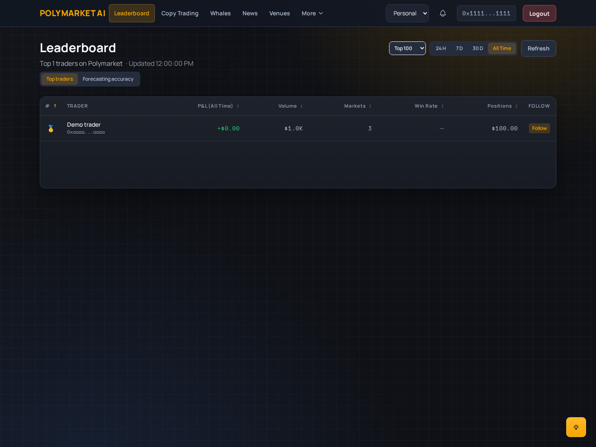

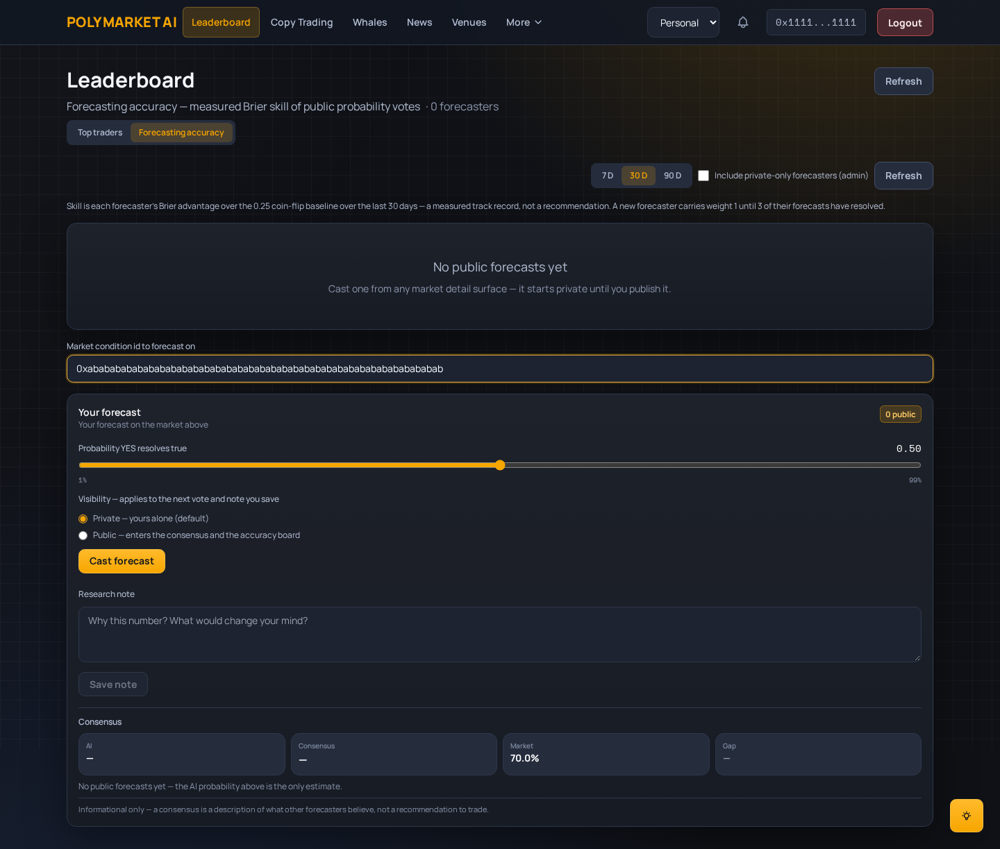

### Copy trading and follower simulation

Open **Copy Trading** to follow a wallet and review per-trader controls, sizing
choices, copy-trade history and evaluation reasons. Configure maximum size and
choose inherited settings, fixed amount, wallet-ratio or Kelly sizing where
available. Configure global limits in **Settings → Trading** and account-specific
limits in **Settings → Accounts**. A Kelly suggestion depends on its probability
and bankroll inputs; it is not a guarantee of profit or permission to trade.

The **Trader Watchlist (Illustrative)** view is a local research aid, separate from
server-side following, real executions and saved follower experiments. Simulation
results do not automatically enable live copying or update that watchlist.

For a reproducible research comparison, use **Simulate following a trader**:

1. Choose **Download synthetic example**, then load it with
   **Import frozen experiment JSON**. Replace it with your own frozen signals and
   bid/ask depth only after understanding the format.
2. Check trader wallet, follow/end timestamps with timezones, funding, per-signal
   USDC notional and fees. A blank fee means unknown; zero is an explicit assumption.
   Delay scenarios come from the imported JSON.
3. Choose **Run and save simulation** and compare each delay’s NAV, net P&L, fees
   and cash against the no-copy baseline.
4. Expand a delay’s **signal outcomes and accounting journal**. Check partial fills,
   nonfills and missing marks, and use **Download journal** for the event list.
5. Reload and open **Saved experiments in this account** to reopen an archived run.

Missing eligible depth or fees prevent fills. Missing fresh final marks make open
position NAV/P&L **Unknown**. Imported inputs and outputs are unverified research.
Follower replay requires `FOLLOWER_REPLAY_ENABLED=true` after migrations.

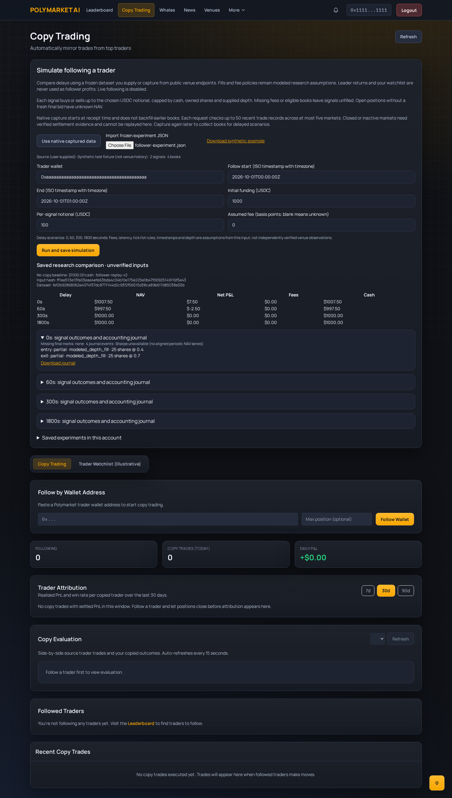

For native evidence, an administrator must also enable `NATIVE_CAPTURE_ENABLED`.
Choose **Use native captured data**, enter a wallet/window/fee assumption, then
**Capture trader and native books now** and **Run and save simulation**. Inspect
**Captured source manifest**, its SHA256 and **Download source manifest**.

A capture reads up to 50 recent trade records across five markets and joins native
Gamma/CLOB identities and depth. It starts at receipt time and does not reconstruct
earlier books. Capture later snapshots for delayed scenarios. Trades before follow
start are excluded; repeated snapshots do not prove replenishment. Closed, paused
or conflicting markets cannot produce a native replay here. Fees and fills remain
modeled, and continuous tracking and native settlement are not provided by this flow.

### Positions, trade history and protection

Open **Trades** to inspect recorded history. Use side/status filters and refresh;
review outcome shares, price, dollar cost, fees, timestamps and transaction state.
A submitted order and a confirmed fill are different states.

Switch to **Your Positions** for holdings. Inspect entry/current prices and
unrealized P&L, then open **Cash Out**, **Stop Loss**, or **Take Profit** for the
relevant position. In protection dialogs, review the token, share amount and
trigger price before saving or cancelling. Protection orders are monitored
instructions, not a guarantee of a fill at the trigger price. Current automated
exit restrictions still apply; an emergency stop does not prove positions closed.

The **Inverse Position Bot** panel controls monitoring, evaluation and sizing
for a position. Check its enable state, current recommendation, confidence,
explanation, last evaluation and any error. Use global inverse defaults in
**Settings → Trading** and review any per-position override before enabling it.


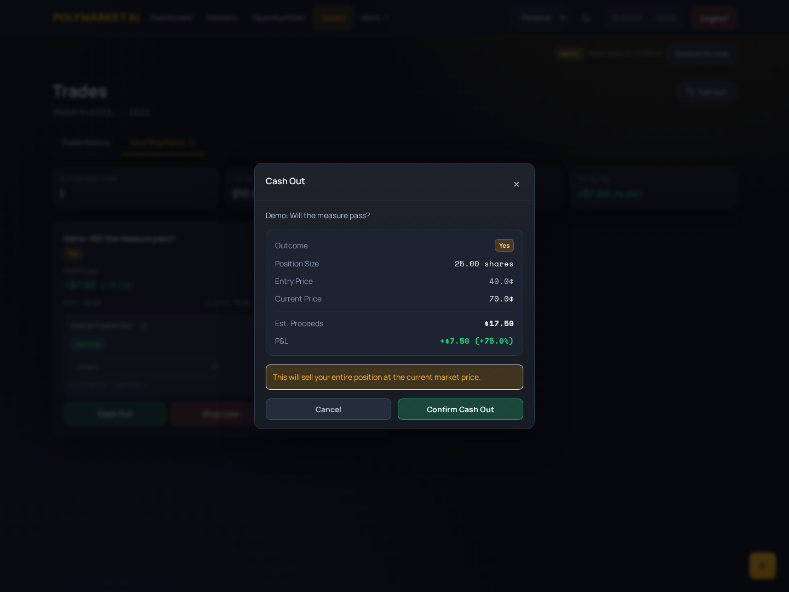

### Market making

Open **Market Making** and choose **+ New Config**. Enter the condition and YES/NO
token IDs, choose BANDS or AMM, and review spread, size/liquidity, price bounds,
collateral and sync interval. Save the configuration before considering Start,
Stop, Sync or enable/disable actions. Check the selected account, paper/live state
and current server restrictions; saving a definition does not establish a fill.

For paper configurations, **Inspect paper quote intents** shows desired quote
definitions. `UNFILLED_DATA_MISSING` means qualifying flow/queue evidence is absent;
`WITHDRAWN` means the definition was removed. These are not resting orders,
reserved inventory or executions. Unchanged paper syncs retain their identities
and add no executed volume. Historical paper counters remain unverified.

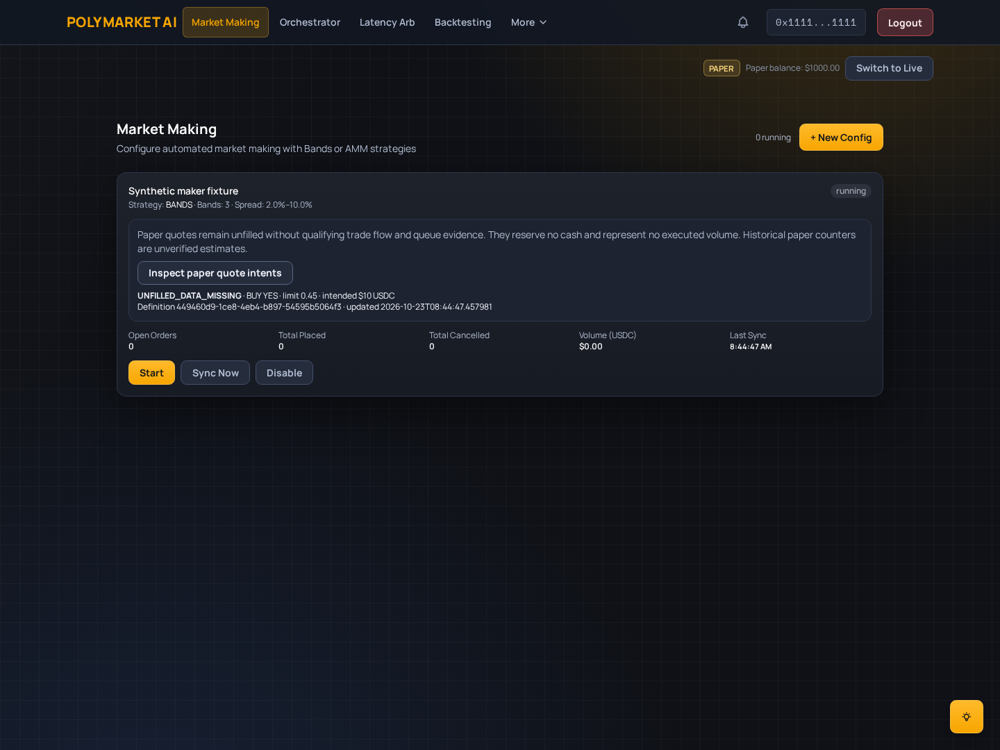

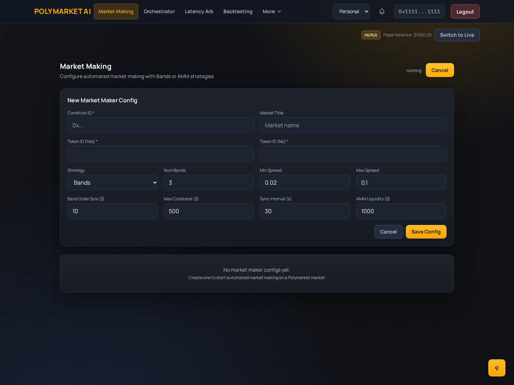

### Backtesting

Open **Backtesting**, choose **+ New Backtest**, select a strategy and date range,
and fill its parameters. Copy-trade replay and indicator strategies have different
input needs; inspect the available strategy description rather than reusing
parameters blindly. Submit the research job and wait for its pending/running state
to become completed or failed.

Open a previous run to inspect its assumptions, trade log and reported metrics;
delete only runs you no longer need. Compare like-for-like windows and costs.
Legacy backtests are not equivalent to the captured follower-journal experiments,
and a reported Sharpe, win rate or P&L is not automatically independently verified.


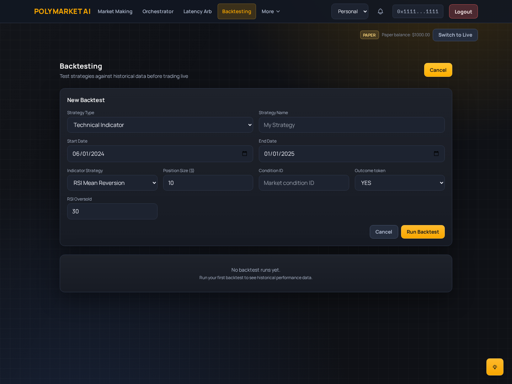

### Latency arbitrage

Open **Latency Arb** for the live edge board, engine status and trade log. Review
symbols and window lengths, model-vs-market probabilities, edge thresholds,
remaining time and latency. Configuration includes maximum notional, daily loss
limit, late-entry policy and opportunity alerts.

Configure conservatively in paper mode where supported and inspect engine errors
and modeled-fill assumptions. An apparent edge is a model comparison; it does not
prove an executable quote, final settlement or realized profit. Current live-order
restrictions remain in force.

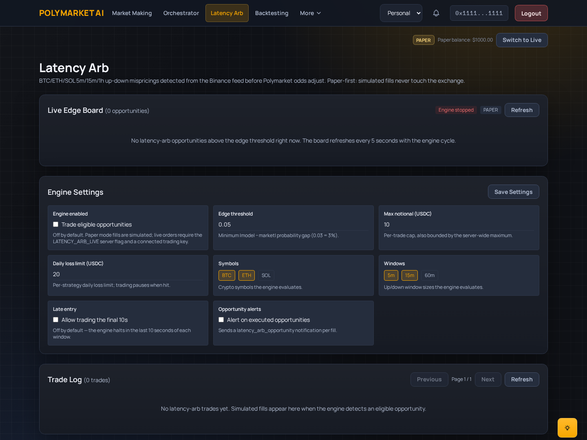

### News and whale monitoring

Open **News** to browse generated market articles. Use **Refresh Feed** to refresh
available coverage, or **Generate Article** with the required market inputs. Read
the summary, underlying context, tags, generation time and provider/model where
shown. Generation needs the configured AI/research services; generated narrative
is research and should be checked against original reporting.

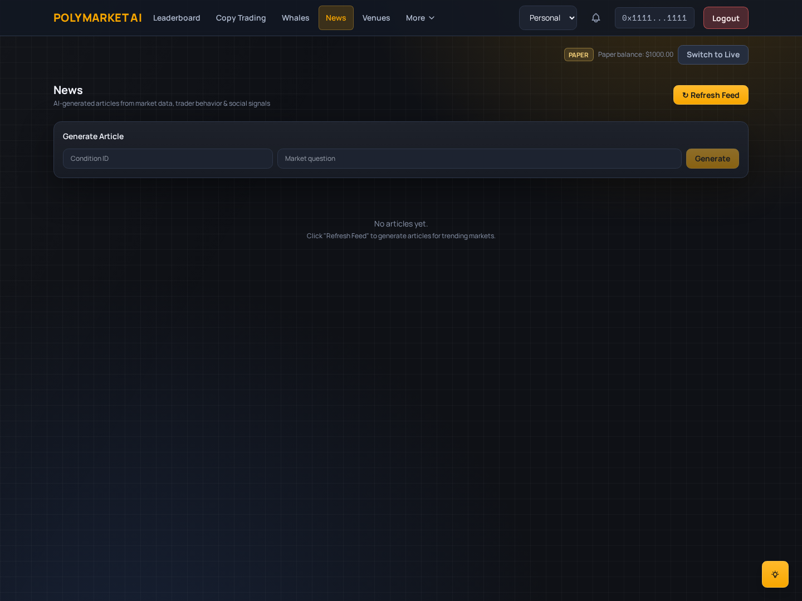

Open **Whales** to review large-wallet activity. Filter by event type or side; use the separate wallet watchlist to choose
addresses to monitor. Set **Min notional (USD)** and the **Leaderboard whale set**,
then choose **Save Settings**. **Auto-copy whale trades** is a separate strategy
control, not a requirement for monitoring. Transfers, splits/merges and redemptions
have different meanings from a directional buy/sell; do not equate every event
with conviction or profit.

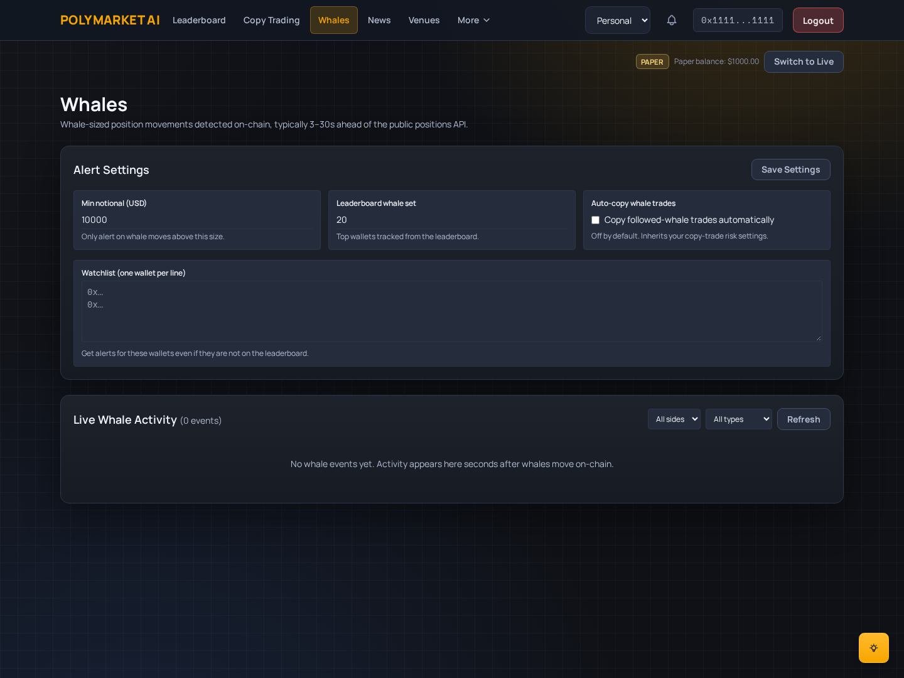

### Risk, execution and forecast analytics

**Risk Report** shows portfolio concentration, value, loss bounds, correlated
clusters and upcoming catalysts, plus a narrative where available. Refresh after
holdings change and distinguish calculated metrics from AI interpretation. Missing
inputs limit the report; it does not guarantee a maximum loss or a timely exit.

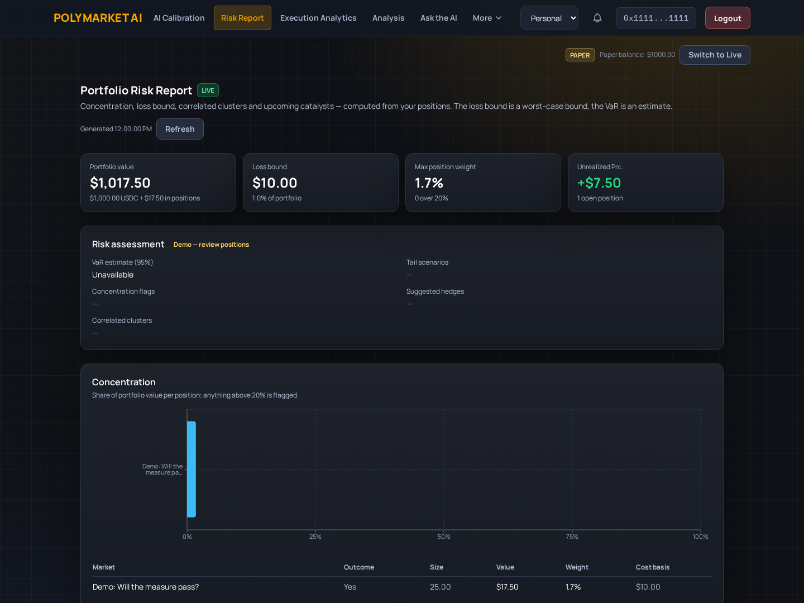

**Execution Analytics** compares submissions/fills, slippage, fees, win rate,
strategy attribution, edge-score inputs and per-trade details. Choose a time window
and strategy, inspect data-quality exclusions and compare expected with actual
execution. Missing fee/expected-price data affects interpretation; empty graphs
mean no eligible recorded executions, not perfect execution.


**AI Calibration** measures recorded probability forecasts against eligible final
outcomes. Choose the time window and scope, inspect sample/resolved
counts, Mean Brier, Brier skill, Avg edge, reliability buckets and model/task/prompt breakdowns.
Review exclusions and unresolved rows before comparing models. The 0.25 Brier
baseline is a reference for binary forecasts, not a promised return.

Forecast rows can expose verdict feedback where supported. Administrators also
review drift and create/manage A/B experiments: define control/variant settings,
compare eligible resolved samples and pause/retire an experiment when appropriate.
An experiment result with insufficient samples should not be treated as a winner.


### Cross-venue signals

Open **Venues** to inspect adapter health, cached market rows and cross-venue or
intra-Polymarket comparisons. Search/filter and review both questions, token/rule
semantics, horizons, liquidity and fetch times before treating rows as comparable.
Play-money sources must remain distinct from real-money venues.

Adapters may be disabled or have no captured data. These rows are read-only
signals: matching titles or price differences do not establish equivalent payouts,
executable prices or a risk-free arbitrage. This page does not submit multi-venue
orders.

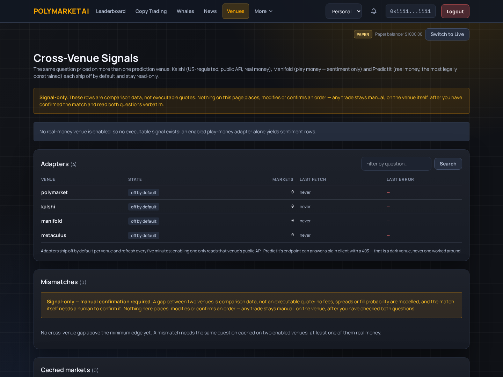

### Accounts, settings and integrations

**Settings → Profile:** edit display name/contact details or avatar and save your
profile. Select a personal AI provider/model and choose **Save AI Preferences**.
The deployment must have usable provider access; selecting a name does not install
or authenticate that provider.


**Settings → Trading:** manage the separate encrypted trading key, copy-trading
mode/sizing/limits and inverse-bot defaults. Login signatures do not supply an
execution key. Review daily loss and maximum-position limits, sizing mode and
AI-approval requirements. Account drawdown, Kelly fraction, paper balance and
simulation controls are under **Accounts**. Disconnecting a key does not prove all existing positions are closed.


**Settings → Notifications:** add a supported channel, enter its channel-specific
details, save it and optionally send a test alert. Configure event routing and
**Save Preferences**; configure daily-digest preferences separately. Test alerts
send a real message in a configured deployment. This guide’s capture does not send
an alert or contain a webhook credential.


**Settings → Accounts:** inspect/create/rename accounts where the deployment and
plan allow them. Select an account before editing its AI, sizing and risk settings.
The active account scopes account-aware histories and experiments; separate local
watchlists and legacy records are not automatically migrated between accounts.

Choose the account’s **Settings** button to review its paper balance, daily loss,
maximum position, drawdown, Kelly fraction, simulation mode and AI approval.
The personal account shares its settings row with the Trading tab.

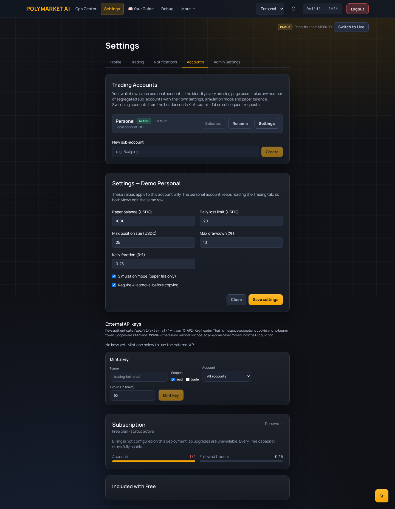

The same tab contains **API Keys** and **Subscription**:

- Give an API key a name, choose read/trade scope, optional account scope and expiry,
  and store its one-time secret securely when creating it. Review last-use/expiry
  and revoke keys you no longer need. Read scope does not grant trading, and trade
  scope does not bypass current server barriers. These keys authenticate the
  external REST API; supported WebSocket position/fill streams are a separate
  integration surface.
- Inspect the current plan, capability/quota usage and available upgrades. Checkout
  and subscription management require billing configuration and may require an
  email address. A pending checkout is not a completed plan upgrade. Account and
  strategy features remain subject to their plan and deployment gates.


### Operations and administration

Open **Ops Center** for risk controls, emergency status, arbitrage scans, category
research and optional Binance smart-money/social/trending/inflow panels. Check
whether a feed is configured and its update time. A disabled feed or empty ranking
is missing information, not a neutral market signal.

Use **Emergency Stop** when you intend to pause automation, then inspect the
operation’s durable status, cancellation confirmations, still-open orders and
unresolved positions. Requested cancellations/exits are different from confirmed
ones. Recovery requests and operator approval, where available, do not bypass a
locked execution barrier. **Rescore Traders** and scan actions produce research
outputs, not live execution approval.


Administrators use **Settings → Admin Settings** to inspect provider health,
set system defaults and review per-user model overrides. Distinguish a provider
being configured from it being healthy. Per-user and account preferences can affect
which backend/model is actually used.

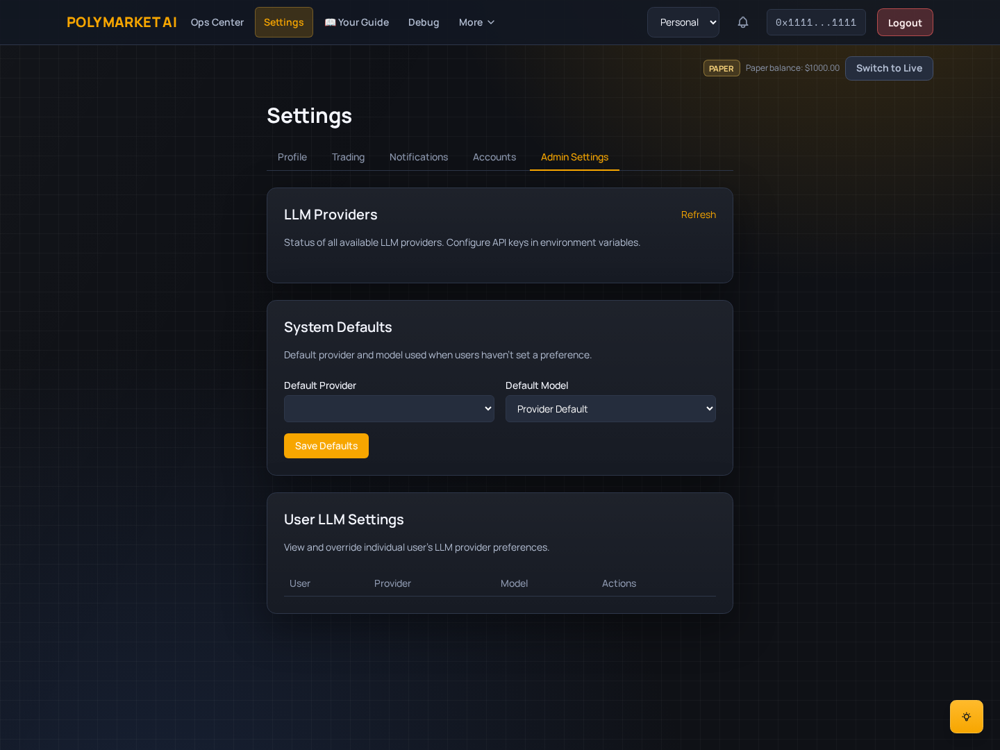

Administrators can also open **Debug** to inspect service health/uptime, endpoint
statistics and filterable request logs. Use level, method, path and limit controls
to narrow a diagnostic investigation; clearing logs removes diagnostic records.
Diagnostic access is separate from ordinary workspace access.


### In-app help

Open **Your Guide** (`/guide`) for searchable help sections and the interactive
tour. Expand the relevant feature section and use the tour to locate controls.
The README’s current implementation limits above take precedence over older
in-app explanatory examples that imply verified performance or unrestricted live
execution.


### Troubleshooting a workflow

| What you see | What to check |
| --- | --- |
| Sign-in prompt or missing private pages | Wallet session and selected account; reconnect if the session expired |
| Provider error, incomplete answer or insufficient evidence | Server provider configuration, research sources, and the displayed missing-input/error details |
| Unavailable native capture or follower replay | Migrations and the deployment’s capture/replay flags; a retained archive is separate from new collection |
| Unknown NAV, unfilled quotes or empty analytics | Eligible books, explicit fees, fresh marks and recorded/verified samples; do not replace missing data with zero |
| Disabled strategy, key, account or upgrade action | Execution restrictions, permissions, feature flags, plan capabilities and quotas |
| Halt reported but exposure remains | Confirmed cancellation/exit counts, still-open orders and unresolved positions, then operator recovery requirements |

<details>
<summary>Refresh all guide screenshots (contributors)</summary>

The opt-in capture config renders the real React application at a 1440 × 1080
viewport. `capture-user-guide.spec.ts` exercises source research/history and
follower/maker workflows against the disposable real API. `capture-app-guide.spec.ts`
uses the explicit demo responses in `user-guide-fixtures.ts` for the wider app,
so captures need no production wallet, trading key, paid provider or billing
account. The fixtures illustrate UI states; they are not evidence that optional
external integrations or live execution are operational.

From the repository root:

```bash
uv sync --project backend --frozen
cd frontend
npm ci
npx playwright install chromium
npx playwright test --config playwright.user-guide.config.ts
```

Ports 8002 and 5187 must be free. The config starts/stops its own backend and Vite
servers. On supported Linux hosts, use `npx playwright install --with-deps chromium`
if browser libraries are missing. The capture scripts write PNGs under
`.github/images/user-guide/`; inspect them with the instructions before committing
a refresh. Normal regression CI does not rewrite these documentation assets.

</details>

## What you can do

### Explore markets and compare prices

- Search and browse markets by category, activity, and event; view related outcomes
  together and see live prices.
- Compare supported prediction-market venues, inspect price differences, and see
  when venue data is stale or incomplete. Comparisons are informational and are not
  executable quotes.
- Follow market news, view generated market briefings, and monitor large-wallet
  activity.

### Research markets and traders

- Request a quick view or a deeper analysis of a market or event.
- Scan a group of markets for opportunities, review sentiment, and request a risk
  assessment or written trade plan.
- Review a trader's history and quality, and ask whether a particular trade fits
  your copy-trading approach.
- See forecast accuracy and calibration summaries to understand how past forecasts
  performed.
- Find related markets using indexed market research.
- Group wallets with similar activity to surface additional research leads.

### Use the AI agents

The workspace has three complementary AI capabilities:

#### Research agent

- Finds context from web search, X posts, and news sources.
- When enabled, adds Binance smart-money signals, active buys, social-hype and
  inflow rankings, trending tokens, token details, and a smart-money P&L leaderboard.
- Looks up cached markets across supported venues to add comparison context.

#### Analysis agent

- Produces market and event analysis, multi-market scans, trader profiles, and
  sentiment summaries.
- Evaluates copy-trade and inverse-position ideas, assesses risk, and writes trade
  plans.
- Uses available market research and crypto signals as supporting evidence.

#### AI Orchestrator

- **Market Deep Dive:** gathers market context, assesses risk, and drafts a trade
  plan.
- **Opportunity Sweep:** scans a supplied group of markets, examines active
  candidates, and assesses a leading opportunity.
- **Trader Diligence:** profiles a trader, evaluates a possible copy trade, and
  assesses its risk.
- Shows each step as it finishes and combines the results. The command palette also
  accepts plain-language questions; voice input is available in supported browsers.

Agents can explain evidence and suggest next steps. The command palette and
Orchestrator do not place or approve orders. Trading is handled separately through
manual order entry or a strategy you explicitly enable. AI provider access and some
research integrations depend on how the workspace is configured.

### Trade and automate

- Review manual-order and cash-out forms, trade history and P&L; live submissions
  remain subject to the execution restrictions described in the guide.
- Copy selected traders with configurable sizing, loss limits, and safety caps.
- Configure market-making strategies, including band and AMM modes.
- Review and manage contrarian positions with the inverse bot.
- Monitor latency-arbitrage opportunities, including paper-trading workflows.
- Set position-level stop-loss and take-profit rules.
- Scan related markets for arbitrage opportunities and track conditional-token
  redemptions.
- Run backtests for copy-trading and indicator strategies against historical data.
- Use paper trading to review decisions and order construction without signing or
  submitting an order.

### Understand portfolio risk and performance

- View balances, open positions, live marks, portfolio value, and realized and
  unrealized performance from the dashboard.
- Review equity snapshots, portfolio risk reports, strategy results, and trader
  performance.
- Inspect execution quality, including fill timing, slippage, and price impact.
- Use optional Kelly-based sizing suggestions alongside the configured position
  limits.

### Stay informed and in control

- Follow leaderboard traders and receive updates when their tracked positions
  change.
- Monitor whale activity, Binance signals, market news, and live price streams.
- Receive in-app, email, or webhook notifications, with preferences, digest options,
  and controls to limit notification bursts.
- Apply pre-trade checks, account cooldowns, daily and monthly loss limits, maximum
  drawdown and position limits, and strategy loss circuit breakers.
- Pause automation with the emergency stop and inspect confirmed cancellations
  and unresolved exposure; current automated-exit restrictions still apply.

### Work across accounts and with a team

- Keep separate accounts or workspaces under one login, with account-specific
  settings.
- Sign in with an injected browser wallet or WalletConnect. Trading credentials are
  configured separately from sign-in and encrypted when stored.
- Share forecasts, build group consensus, and review contributor attribution.
- Create experiments and compare their results.
- Keep an audit trail of key account and trading actions.
- Manage subscriptions and plan-based features when billing is configured.
- Create scoped API keys for the external REST API and stream positions and fills
  through the WebSocket API.

### Administration

When administrator access is enabled, available tools include service health and
diagnostics, user and AI-provider settings, model approval and drift monitoring,
and operational logs. Forecast quality tools compare results across models and
prompt versions.

### Source-backed market research

Open an Opportunities market's details and choose **Research market** to review
server-fetched rules, outcome tokens, indicative prices and source timestamps.
**Run Deep Dive** adds typed supporting/contradicting claims and missing
information through the existing user-selected AI provider. The legacy analysis
action remains available.

The backend sends structured research instructions in a separate, additive gRPC
field; both AI services select a research-only prompt instead of their legacy
forecast/trade template. Deploy the backend and AI services together. An older
service without the research-contract acknowledgement fails explicitly rather
than silently falling back to a different analysis format.

Matched quotations establish attribution within captured venue text or
source-delimited Tavily excerpts, not factual truth or verified interpretation.
Other research formats stay unverified. Unsupported pivotal claims, missing
market inputs or invalid model output produce **Insufficient evidence**.
**Investigate further** never approves an order. Quote freshness, semantic rule
verification, calibrated probabilities and executable economics remain explicit
limits. Public source observations are persisted with their receipt time and
rule/token identity. **Source observation history** can filter these by a UTC
as-of cutoff; later observations never appear in an earlier view. No historical
book depth is inferred from token prices, and private briefs are not persisted.

Run `npm run test:research` from `frontend` after installing the frozen backend
environment, frontend dependencies and Playwright Chromium. It runs the real API
and browser against disposable venue/agent fixtures, without provider keys or a
production database; ports 8002 and 5187 must be free. CI runs this suite alongside
the existing full-stack E2E suite. Backend regressions are in
`test_market_context.py`, `test_market_research.py` and
`test_analysis_routes_coverage.py`.

## System design

The web app is the main workspace. It sends requests to the application backend,
which handles accounts, market and trading operations, safety checks, and data
storage. AI requests are routed to the configured analysis services. The research
tools gather supporting context, and notifications can be delivered through the
channels enabled for the account.

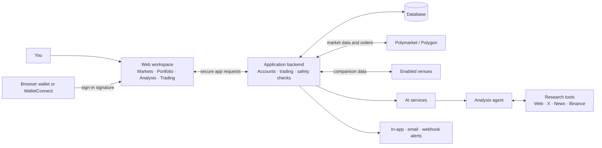

### Agent orchestration

The Orchestrator expands a request into ordered steps, sends each step to the
analysis backend selected for the configured AI provider, and gathers the results.
Progress and the final combined summary stream back to the workspace.

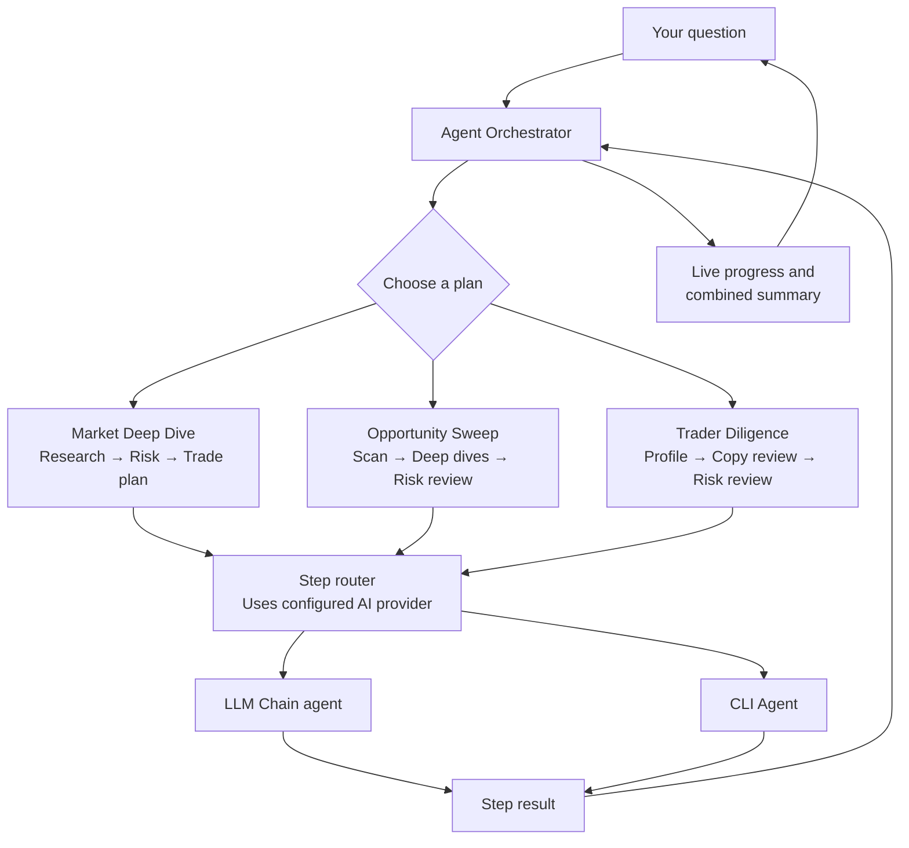

### Agent tools and MCP delegation

Both analysis agents share the `polymarket_mcp` client. Its current research path
delegates web search, X-post search, and (when enabled) Binance market context to
the Research MCP server. The LLM Chain also has direct web/news integrations and
indexed-market retrieval.

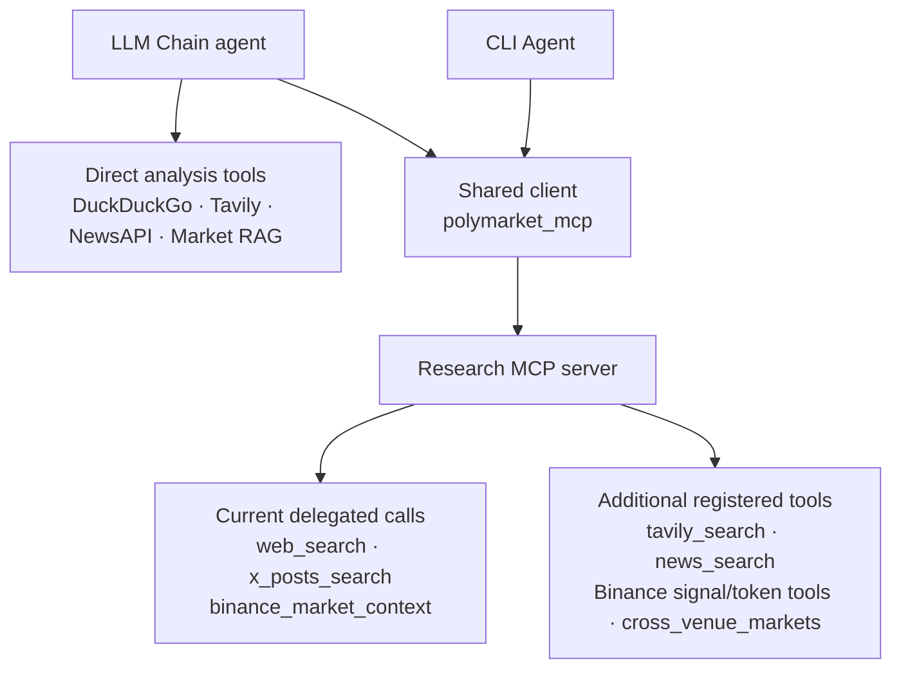

The Research MCP registry also includes Binance smart-money signals, active buys,
social hype and inflow rankings, trending tokens, token search and data, and a P&L
leaderboard. Tavily, NewsAPI, Binance Skills, and cross-venue data depend on
deployment configuration; not every registered tool runs on every request.
Research results provide context and are not automatically converted into orders.

An AI response is a research aid. The Orchestrator and command palette stop at an
analysis summary or written plan; they do not submit or approve orders. A separately
enabled trading strategy follows its own account settings and safety limits.

## How to use the project

This project is self-hosted. The simplest way to run the full workspace is with
Docker Compose:

```bash
cp .env.example .env
# Follow .env.example to generate the required application secrets.
# Add an API key for the AI provider you want to use.
docker compose up --build
```

Then use the workspace:

1. Open the application at your deployment URL. Connect a browser wallet or
   WalletConnect wallet and sign the login request.
2. Start with **Markets**, **Opportunities**, or **Leaderboard** to browse markets,
   compare activity, and find traders to research.
3. Open **Analysis** for a focused market or trader review. Choose **Ask the AI** or
   **Orchestrator** to run a Market Deep Dive, Opportunity Sweep, or Trader Diligence
   plan and follow its progress.
4. Review your balances and positions on the **Dashboard**. Use **Risk Report**,
   **AI Calibration**, and **Execution Analytics** to inspect portfolio risk,
   forecast performance, and trade quality.
5. To automate trading, add a trading key separately in **Settings**, configure the
   strategy and its limits, and use paper trading first. Enable a live strategy only
   when its settings are correct. Use the emergency stop to pause automation.

An AI provider key is needed for AI analysis. Optional research services can add
news, premium search, and crypto signals. Check `.env.example` for configuration
details. Set provider credentials on the server; never put secrets in `VITE_`
browser settings or commit them to the project.

## License

This software is source-available under the [PolyForm Noncommercial License 1.0.0](LICENSE).

Commercial use, including incorporation into commercial products or services, requires a separate commercial license from the copyright holder, except for purposes expressly permitted by the license (including its Noncommercial Organizations provision). Noncommercial use, modification, and redistribution are permitted subject to the full license terms.

For commercial licensing, contact [eslam-aboutaleb](https://github.com/eslam-aboutaleb).

Third-party dependencies and separately identified third-party code retain their own licenses. This license applies only to rights the copyright holder is entitled to license. Previously granted licenses for earlier versions are not revoked by this change.

### Shared replay accounting

`analytics/replay/ledger.py` defines `paper-ledger-v1`: Decimal USDC cash,
explicit share inventory and cost basis, cash/share reservations, idempotent
partial fills, cancellation and modeled settlement. NAV counts reserved cash
once and stays unknown when an open position has no supplied mark. The journal
retains event identities, economic inputs and balances after each event. Inputs
are bounded to 28 significant digits and exponents from -28 through 28; arithmetic
uses a private 256-digit, half-even Decimal context. Each event is staged and
committed only after all accounting invariants pass.
This is a replay primitive; legacy paper strategy results remain unverified
and are not automatically imported or relabeled as journal-backed returns.

### Follower replay experiments (research only)

Set `FOLLOWER_REPLAY_ENABLED=true` after `alembic upgrade head` to enable
`/api/copy-trading/experiments`. The Copy Trading page imports a frozen JSON
experiment, compares configured delays, saves it to the authenticated account,
and lets you inspect each outcome and download its cash/share journal. The
included downloadable example is explicitly synthetic. Disabling the flag
stops new runs and reads without deleting archives.

Inputs contain wallet, follow/end times, funding, per-signal USDC notional,
explicit fee assumptions, delays, tick/lot rules and a dataset of first-seen
signals, receipt/source-timestamped bid/ask share depth and optional settlement
payouts. Maximums are 50 signals, 250 books, 10 levels per side and four delays.
Only eligible post-observation books inside the wait window can fill; stale,
missing, invalid or exhausted evidence never becomes an assumed execution.
Each signal buys or sells up to its USDC notional with cash and inventory caps.
Best-bid marks are indicative and require freshness at the experiment end;
unpriced positions make NAV and net P&L unknown. Sharpe remains unavailable.

All imported evidence and fee/settlement policies are **user supplied and
unverified**, including numeric results. These runs do not demonstrate trader
skill or future profit, collect historical venue books, update the local
watchlist, change legacy paper accounts, or enable live orders. Inputs, hashes,
policy versions and outputs are archived separately from legacy backtests and
live trades. The next integration work is captured book datasets and migration
of legacy strategy runners to the journal; #6/#27/#35/#55/#58 remain open.

### Maker paper quote correction

Maker paper syncs now persist desired quote definitions with stable UUIDs and
`maker-no-evidence-no-fill-v1`. Without observed qualifying flow and queue
assumptions, they remain `UNFILLED_DATA_MISSING`; removed definitions become
`WITHDRAWN`. Definitions are not resting orders, inventory reservations or
executions. Repeated static syncs never create trades or increase executed
volume. Inspect definitions on each Market Making card. The account-scoped
read endpoint is `/api/market-maker/configs/{id}/paper-intents` (latest 100).

Run migration0031 before deployment. Historical counters/trades are preserved
as unverified estimates; this correction does not repair historical performance
or complete #34's queue/flow lifecycle. Paper fill eligibility stays disabled
until those inputs exist. A definition may be reselected under the same ID;
this is not a canceled execution order being reopened. No signing or CLOB
mutation is added, and this correction intentionally has no switch back to
phantom-fill behavior.

### Native follower capture deployment

Run `alembic upgrade head` through revision `20261023_0032_native_replay_capture`
before deployment. Set `NATIVE_CAPTURE_ENABLED=true` to allow new bounded public
captures and `FOLLOWER_REPLAY_ENABLED=true` to run/reopen follower experiments.
Both default to false. Turning capture off stops collection while retained public
evidence and existing experiment archives remain readable under their normal
access controls. Saved experiments stay private to their owning account; source
captures contain public venue responses and are readable by authenticated users.

Native evidence is append-only at the application boundary, not a database
anti-tampering guarantee. The raw payload hash, rule/mapping fingerprint, receipt
and source clocks are retained in a separately hashed native manifest. Replay
inputs and results are frozen in the existing account archive. The simulator now
reports `follower-replay-v2`; older saved results are retained unchanged. This
slice does not add historical venue datasets, automatic settlement, trader-skill
scoring, continuous collection, or legacy paper-runner/NAV migration.


### Live execution setup

Real CLOB v2 execution is available for manual orders/cash-out, copy trading,
market making, latency arbitrage, inverse reversals and conditional exits.
Simulation and historical replay remain separate and cannot authorize live orders.

1. Install the locked backend dependencies with `uv sync --frozen`, then run
   `uv run --frozen alembic upgrade head` from `backend/`.
2. Configure the trading key in Settings. Choose the actual EOA, Polymarket proxy,
   Safe or deposit wallet type; contract wallets require the funding address.
3. Set risk budgets and initial capital. `LIVE_TRADING_ENABLED`, the strategy
   flags and `LATENCY_ARB_LIVE` default to true. Both Compose web and worker
   services receive these flags; operators can set them to false to disable live
   features. Choose paper/simulation mode when using virtual funds.
4. An administrator activates global execution with `POST /api/v1/risk/activate`
   and `{"scope":"global"}`. Each wallet owner then activates their own account.
   The Copy Trading panel exposes activation, initial capital, simulation/stop
   controls and owned live-order checks/cancellation. Following wallets and
   configuring sizing remain explicit steps.

Manual/external order requests require a stable `Idempotency-Key`. BUY API sizes
are collateral notional; SELL API sizes are shares. The internal gateway always
uses shares. Orders and principal reservations commit before submission; an
unknown acknowledgement retains its reservation and never automatically retries.
Authenticated confirmation and settlement evidence own execution prices and
quantities. A missing order never proves cancellation.
Recovery rotates failed observations behind unattempted orders. Exchange calls
run outside the event loop, and cancellation waits for session ownership to return.
Followed-wallet polling uses the public Data API with stable source identities;
an optional WebSocket timeout does not stop subsequent polling.

Purchase principal is conservatively charged against shared wallet budgets and
any selected sub-account budget. Only exchange-confirmed cancellation releases
unfilled reservations; simulated or unverified profits never replenish budgets.
These controls are spending limits, not a verified NAV/margin ledger. Historical
live exposure outside the new ledger blocks new purchases until migrated.
Inventory-backed exits remain available after activation. Inverse reversals pause
when either leg's settlement is uncertain, and maker shutdown verifies only the
orders owned by that configuration.

Emergency halt persists before cancellation and includes durable unknown orders
even when the open-order snapshot is empty. It does not claim positions closed
or implement automatic liquidation. Independent analysis still has no general
raw-analysis history store. Other venues remain research/data adapters.

Verification used a disposable PostgreSQL instance and mocked remote exchange I/O;
no funded orders were submitted. The full backend suite, PostgreSQL concurrency
checks, browser safety flows, frontend build and migration upgrade/downgrade
checks passed. Existing repository-wide frontend lint findings remain unchanged.
