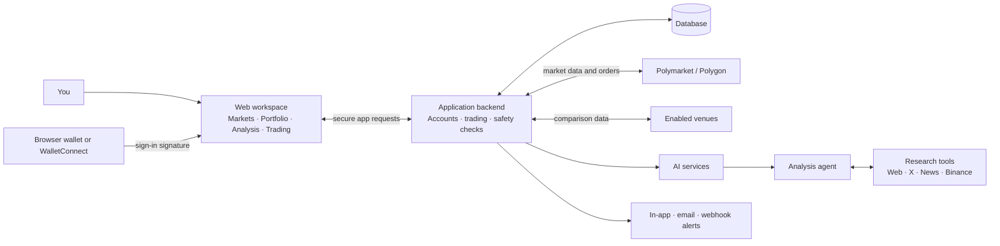
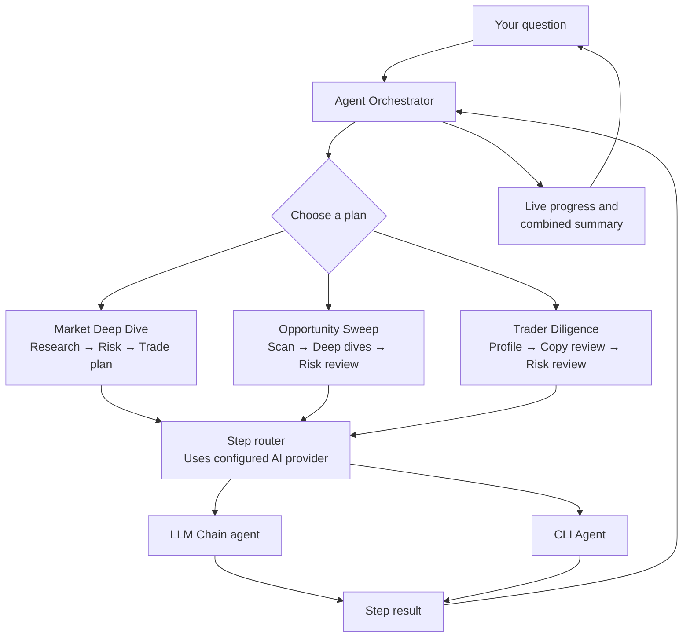
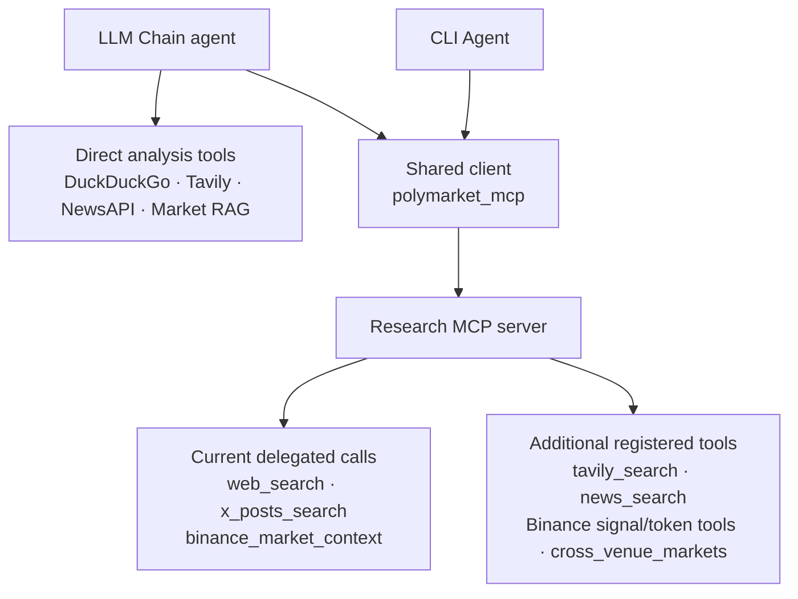

# Polymarket Research & Trading Workspace

A self-hosted workspace for exploring prediction markets, researching opportunities,
following your portfolio, and managing trading strategies from one place. Connect a
wallet, choose how much automation you want, and use the research agents to turn a
question into a clear, reviewable analysis.

[Read the illustrated user guide](user%20guide/README.md) for step-by-step instructions
and screenshots of the application.

## What you can do

### Explore markets and compare prices

- Search and browse markets by category, activity, and event; view related outcomes
  together and see live prices.
- Compare supported prediction-market venues, inspect price differences, and see
  when venue data is stale or incomplete. Comparisons are informational and are not
  executable quotes.
- Follow market news, view generated market briefings, and monitor large-wallet
  activity.

### Research markets and traders

- Request a quick view or a deeper analysis of a market or event.
- Scan a group of markets for opportunities, review sentiment, and request a risk
  assessment or written trade plan.
- Review a trader's history and quality, and ask whether a particular trade fits
  your copy-trading approach.
- See forecast accuracy and calibration summaries to understand how past forecasts
  performed.
- Find related markets using indexed market research.
- Group wallets with similar activity to surface additional research leads.

### Use the AI agents

The workspace has three complementary AI capabilities:

#### Research agent

- Finds context from web search, X posts, and news sources.
- When enabled, adds Binance smart-money signals, active buys, social-hype and
  inflow rankings, trending tokens, token details, and a smart-money P&L leaderboard.
- Looks up cached markets across supported venues to add comparison context.

#### Analysis agent

- Produces market and event analysis, multi-market scans, trader profiles, and
  sentiment summaries.
- Evaluates copy-trade and inverse-position ideas, assesses risk, and writes trade
  plans.
- Uses available market research and crypto signals as supporting evidence.

#### AI Orchestrator

- **Market Deep Dive:** gathers market context, assesses risk, and drafts a trade
  plan.
- **Opportunity Sweep:** scans a supplied group of markets, examines active
  candidates, and assesses a leading opportunity.
- **Trader Diligence:** profiles a trader, evaluates a possible copy trade, and
  assesses its risk.
- Shows each step as it finishes and combines the results. The command palette also
  accepts plain-language questions; voice input is available in supported browsers.

Agents can explain evidence and suggest next steps. The command palette and
Orchestrator do not place or approve orders. Trading is handled separately through
manual order entry or a strategy you explicitly enable. AI provider access and some
research integrations depend on how the workspace is configured.

### Trade and automate

- Review manual-order and cash-out forms, trade history and P&L; live submissions
  remain subject to the execution restrictions described in the guide.
- Copy selected traders with configurable sizing, loss limits, and safety caps.
- Configure market-making strategies, including band and AMM modes.
- Review and manage contrarian positions with the inverse bot.
- Monitor latency-arbitrage opportunities, including paper-trading workflows.
- Set position-level stop-loss and take-profit rules.
- Scan related markets for arbitrage opportunities and track conditional-token
  redemptions.
- Run backtests for copy-trading and indicator strategies against historical data.
- Use paper trading to review decisions and order construction without signing or
  submitting an order.

### Understand portfolio risk and performance

- View balances, open positions, live marks, portfolio value, and realized and
  unrealized performance from the dashboard.
- Review equity snapshots, portfolio risk reports, strategy results, and trader
  performance.
- Inspect execution quality, including fill timing, slippage, and price impact.
- Use optional Kelly-based sizing suggestions alongside the configured position
  limits.

### Stay informed and in control

- Follow leaderboard traders and receive updates when their tracked positions
  change.
- Monitor whale activity, Binance signals, market news, and live price streams.
- Receive in-app, email, or webhook notifications, with preferences, digest options,
  and controls to limit notification bursts.
- Apply pre-trade checks, account cooldowns, daily and monthly loss limits, maximum
  drawdown and position limits, and strategy loss circuit breakers.
- Pause automation with the emergency stop and inspect confirmed cancellations
  and unresolved exposure; current automated-exit restrictions still apply.

### Work across accounts and with a team

- Keep separate accounts or workspaces under one login, with account-specific
  settings.
- Sign in with an injected browser wallet or WalletConnect. Trading credentials are
  configured separately from sign-in and encrypted when stored.
- Share forecasts, build group consensus, and review contributor attribution.
- Create experiments and compare their results.
- Keep an audit trail of key account and trading actions.
- Manage subscriptions and plan-based features when billing is configured.
- Create scoped API keys for the external REST API and stream positions and fills
  through the WebSocket API.

### Administration

When administrator access is enabled, available tools include service health and
diagnostics, user and AI-provider settings, model approval and drift monitoring,
and operational logs. Forecast quality tools compare results across models and
prompt versions.

### Source-backed market research

Open an Opportunities market's details and choose **Research market** to review
server-fetched rules, outcome tokens, indicative prices and source timestamps.
**Run Deep Dive** adds typed supporting/contradicting claims and missing
information through the existing user-selected AI provider. The legacy analysis
action remains available.

The backend sends structured research instructions in a separate, additive gRPC
field; both AI services select a research-only prompt instead of their legacy
forecast/trade template. Deploy the backend and AI services together. An older
service without the research-contract acknowledgement fails explicitly rather
than silently falling back to a different analysis format.

Matched quotations establish attribution within captured venue text or
source-delimited Tavily excerpts, not factual truth or verified interpretation.
Other research formats stay unverified. Unsupported pivotal claims, missing
market inputs or invalid model output produce **Insufficient evidence**.
**Investigate further** never approves an order. Quote freshness, semantic rule
verification, calibrated probabilities and executable economics remain explicit
limits. Public source observations are persisted with their receipt time and
rule/token identity. **Source observation history** can filter these by a UTC
as-of cutoff; later observations never appear in an earlier view. No historical
book depth is inferred from token prices, and private briefs are not persisted.

Run `npm run test:research` from `frontend` after installing the frozen backend
environment, frontend dependencies and Playwright Chromium. It runs the real API
and browser against disposable venue/agent fixtures, without provider keys or a
production database; ports 8002 and 5187 must be free. CI runs this suite alongside
the existing full-stack E2E suite. Backend regressions are in
`test_market_context.py`, `test_market_research.py` and
`test_analysis_routes_coverage.py`.

## System design

The web app is the main workspace. It sends requests to the application backend,
which handles accounts, market and trading operations, safety checks, and data
storage. AI requests are routed to the configured analysis services. The research
tools gather supporting context, and notifications can be delivered through the
channels enabled for the account.



### Agent orchestration

The Orchestrator expands a request into ordered steps, sends each step to the
analysis backend selected for the configured AI provider, and gathers the results.
Progress and the final combined summary stream back to the workspace.



### Agent tools and MCP delegation

Both analysis agents share the `polymarket_mcp` client. Its current research path
delegates web search, X-post search, and (when enabled) Binance market context to
the Research MCP server. The LLM Chain also has direct web/news integrations and
indexed-market retrieval.



The Research MCP registry also includes Binance smart-money signals, active buys,
social hype and inflow rankings, trending tokens, token search and data, and a P&L
leaderboard. Tavily, NewsAPI, Binance Skills, and cross-venue data depend on
deployment configuration; not every registered tool runs on every request.
Research results provide context and are not automatically converted into orders.

An AI response is a research aid. The Orchestrator and command palette stop at an
analysis summary or written plan; they do not submit or approve orders. A separately
enabled trading strategy follows its own account settings and safety limits.

## How to use the project

This project is self-hosted. The simplest way to run the full workspace is with
Docker Compose:

```bash
cp .env.example .env
# Follow .env.example to generate the required application secrets.
# Add an API key for the AI provider you want to use.
docker compose up --build
```

Then use the workspace:

1. Open the application at your deployment URL. Connect a browser wallet or
   WalletConnect wallet and sign the login request.
2. Start with **Markets**, **Opportunities**, or **Leaderboard** to browse markets,
   compare activity, and find traders to research.
3. Open **Analysis** for a focused market or trader review. Choose **Ask the AI** or
   **Orchestrator** to run a Market Deep Dive, Opportunity Sweep, or Trader Diligence
   plan and follow its progress.
4. Review your balances and positions on the **Dashboard**. Use **Risk Report**,
   **AI Calibration**, and **Execution Analytics** to inspect portfolio risk,
   forecast performance, and trade quality.
5. To automate trading, add a trading key separately in **Settings**, configure the
   strategy and its limits, and use paper trading first. Enable a live strategy only
   when its settings are correct. Use the emergency stop to pause automation.

An AI provider key is needed for AI analysis. Optional research services can add
news, premium search, and crypto signals. Check `.env.example` for configuration
details. Set provider credentials on the server; never put secrets in `VITE_`
browser settings or commit them to the project.

## License

This software is source-available under the [PolyForm Noncommercial License 1.0.0](LICENSE).

Commercial use, including incorporation into commercial products or services, requires a separate commercial license from the copyright holder, except for purposes expressly permitted by the license (including its Noncommercial Organizations provision). Noncommercial use, modification, and redistribution are permitted subject to the full license terms.

For commercial licensing, contact [eslam-aboutaleb](https://github.com/eslam-aboutaleb).

Third-party dependencies and separately identified third-party code retain their own licenses. This license applies only to rights the copyright holder is entitled to license. Previously granted licenses for earlier versions are not revoked by this change.

### Shared replay accounting

`analytics/replay/ledger.py` defines `paper-ledger-v1`: Decimal USDC cash,
explicit share inventory and cost basis, cash/share reservations, idempotent
partial fills, cancellation and modeled settlement. NAV counts reserved cash
once and stays unknown when an open position has no supplied mark. The journal
retains event identities, economic inputs and balances after each event. Inputs
are bounded to 28 significant digits and exponents from -28 through 28; arithmetic
uses a private 256-digit, half-even Decimal context. Each event is staged and
committed only after all accounting invariants pass.
This is a replay primitive; legacy paper strategy results remain unverified
and are not automatically imported or relabeled as journal-backed returns.

### Follower replay experiments (research only)

Set `FOLLOWER_REPLAY_ENABLED=true` after `alembic upgrade head` to enable
`/api/copy-trading/experiments`. The Copy Trading page imports a frozen JSON
experiment, compares configured delays, saves it to the authenticated account,
and lets you inspect each outcome and download its cash/share journal. The
included downloadable example is explicitly synthetic. Disabling the flag
stops new runs and reads without deleting archives.

Inputs contain wallet, follow/end times, funding, per-signal USDC notional,
explicit fee assumptions, delays, tick/lot rules and a dataset of first-seen
signals, receipt/source-timestamped bid/ask share depth and optional settlement
payouts. Maximums are 50 signals, 250 books, 10 levels per side and four delays.
Only eligible post-observation books inside the wait window can fill; stale,
missing, invalid or exhausted evidence never becomes an assumed execution.
Each signal buys or sells up to its USDC notional with cash and inventory caps.
Best-bid marks are indicative and require freshness at the experiment end;
unpriced positions make NAV and net P&L unknown. Sharpe remains unavailable.

All imported evidence and fee/settlement policies are **user supplied and
unverified**, including numeric results. These runs do not demonstrate trader
skill or future profit, collect historical venue books, update the local
watchlist, change legacy paper accounts, or enable live orders. Inputs, hashes,
policy versions and outputs are archived separately from legacy backtests and
live trades. The next integration work is captured book datasets and migration
of legacy strategy runners to the journal; #6/#27/#35/#55/#58 remain open.

### Maker paper quote correction

Maker paper syncs now persist desired quote definitions with stable UUIDs and
`maker-no-evidence-no-fill-v1`. Without observed qualifying flow and queue
assumptions, they remain `UNFILLED_DATA_MISSING`; removed definitions become
`WITHDRAWN`. Definitions are not resting orders, inventory reservations or
executions. Repeated static syncs never create trades or increase executed
volume. Inspect definitions on each Market Making card. The account-scoped
read endpoint is `/api/market-maker/configs/{id}/paper-intents` (latest 100).

Run migration0031 before deployment. Historical counters/trades are preserved
as unverified estimates; this correction does not repair historical performance
or complete #34's queue/flow lifecycle. Paper fill eligibility stays disabled
until those inputs exist. A definition may be reselected under the same ID;
this is not a canceled execution order being reopened. No signing or CLOB
mutation is added, and this correction intentionally has no switch back to
phantom-fill behavior.

### Native follower capture deployment

Run `alembic upgrade head` through revision `20261023_0032_native_replay_capture`
before deployment. Set `NATIVE_CAPTURE_ENABLED=true` to allow new bounded public
captures and `FOLLOWER_REPLAY_ENABLED=true` to run/reopen follower experiments.
Both default to false. Turning capture off stops collection while retained public
evidence and existing experiment archives remain readable under their normal
access controls. Saved experiments stay private to their owning account; source
captures contain public venue responses and are readable by authenticated users.

Native evidence is append-only at the application boundary, not a database
anti-tampering guarantee. The raw payload hash, rule/mapping fingerprint, receipt
and source clocks are retained in a separately hashed native manifest. Replay
inputs and results are frozen in the existing account archive. The simulator now
reports `follower-replay-v2`; older saved results are retained unchanged. This
slice does not add historical venue datasets, automatic settlement, trader-skill
scoring, continuous collection, or legacy paper-runner/NAV migration.


### Live execution setup

Real CLOB v2 execution is available for manual orders/cash-out, copy trading,
market making, latency arbitrage, inverse reversals and conditional exits.
Simulation and historical replay remain separate and cannot authorize live orders.

1. Install the locked backend dependencies with `uv sync --frozen`, then run
   `uv run --frozen alembic upgrade head` from `backend/`.
2. Configure the trading key in Settings. Choose the actual EOA, Polymarket proxy,
   Safe or deposit wallet type; contract wallets require the funding address.
3. Set risk budgets and initial capital. `LIVE_TRADING_ENABLED`, the strategy
   flags and `LATENCY_ARB_LIVE` default to true. Both Compose web and worker
   services receive these flags; operators can set them to false to disable live
   features. Choose paper/simulation mode when using virtual funds.
4. An administrator activates global execution with `POST /api/v1/risk/activate`
   and `{"scope":"global"}`. Each wallet owner then activates their own account.
   The Copy Trading panel exposes activation, initial capital, simulation/stop
   controls and owned live-order checks/cancellation. Following wallets and
   configuring sizing remain explicit steps.

Purchase principal is conservatively charged against shared wallet budgets and
any selected sub-account budget. Only exchange-confirmed cancellation releases
unfilled reservations; simulated or unverified profits never replenish budgets.
These controls are spending limits, not a verified NAV/margin ledger. Historical
live exposure outside the new ledger blocks new purchases until migrated.
Inventory-backed exits remain available after activation. Inverse reversals pause
when either leg's settlement is uncertain, and maker shutdown verifies only the
orders owned by that configuration.

Emergency halt persists before cancellation and includes durable unknown orders
even when the open-order snapshot is empty. It does not claim positions closed
or implement automatic liquidation. Independent analysis still has no general
raw-analysis history store. Other venues remain research/data adapters.

## WalletConnect configuration and browser tests

Set `VITE_WALLETCONNECT_PROJECT_ID` in the frontend environment to the project ID
from the Reown dashboard. For GitHub Actions, add a repository Actions secret with
that exact name


For portable model gateway configuration, embedding connection overrides and vector
reindexing requirements, see [LiteLLM gateway integration](docs/litellm-gateway.md).

### Journal-backed paper accounts

See [Paper accounts and NAV](user%20guide/paper-accounting.md) for setup, fill/fee assumptions,
legacy-history handling, hourly NAV, tests and operator rollout for #27/#35.

See [Frozen executable replay](user%20guide/executable-replay.md) for costed depth replay, periodic NAV statistics, frozen strategy families and evidence assumptions.
