# User guide

[Project overview and system design](../README.md)

This guide covers the application’s public pages, signed-in workspace, strategy
screens, analytics, settings and administrator tools. Start the self-hosted
workspace using [How to use the project](../README.md#how-to-use-the-project), then follow the
workflow you need below. Navigation groups are under **More** on desktop and the
navigation menu on smaller screens; administrator entries require an admin account.

All screenshots are captured from the running application with synthetic demo
accounts, markets and API responses. Research/simulation examples use the disposable
real-API fixture app; the wider screen examples use controlled browser API fixtures.
Displayed balances, prices and example results are illustrations, not live account
statements or demonstrated returns. Empty charts show where a fresh workspace has
no observations; they are not populated with invented trading history.

Live trading features are enabled by default through the durable execution gateway.
Real orders require server strategy switches, global administrator activation, wallet activation and
risk budgets. Simulation and replay never grant live authority. Legacy direct
signers remain blocked. See the [live execution setup](../README.md#live-execution-setup)
for the supported paths and remaining limits.

| Goal | Start here | Access or prerequisite |
| --- | --- | --- |
| Browse and save markets | [Markets and manual orders](#markets-watchlists-and-manual-orders) | Browsing is public; trading requires a session |
| Research a market | [Opportunities and research](#opportunities-and-market-research) | AI generation needs a configured provider |
| Ask questions or run a plan | [AI and orchestration](#ask-the-ai-and-orchestration) | Sign in and configure an AI provider |
| Find traders and forecasters | [Leaderboard and collaboration](#leaderboard-trader-research-and-collaboration) | Public board; sign in to follow or contribute |
| Follow or simulate a trader | [Copy trading](#copy-trading-and-follower-simulation) | Sign in; simulation/capture flags as described below |
| Review holdings and exits | [Positions and trade history](#positions-trade-history-and-protection) | Signed-in account |
| Configure a strategy | [Market making](#market-making), [backtesting](#backtesting), [latency arbitrage](#latency-arbitrage) | Signed-in account; capabilities depend on deployment/plan |
| Monitor information | [News and whales](#news-and-whale-monitoring), [venues](#cross-venue-signals) | Sign in; optional feeds need server configuration |
| Review performance | [Risk, execution and calibration](#risk-execution-and-forecast-analytics) | Sign in; metrics require eligible recorded data |
| Configure your workspace | [Accounts and settings](#accounts-settings-and-integrations) | Sign in; billing/provider features depend on configuration |
| Inspect operations | [Operations and administration](#operations-and-administration) | Ops requires sign-in; diagnostics/admin settings require admin |

## Sign in and find your way

1. Open **Login** or choose a sign-in action on a public page.
2. Choose your browser wallet or WalletConnect, then approve
   the login signature. WalletConnect is enabled when the frontend is built
   with `VITE_WALLETCONNECT_PROJECT_ID` (the frontend CI build reads it from the GitHub Actions repository secret of the same name). For Docker Compose production deployments, also supply it through the deployment environment or `.env.prod` before rebuilding.
   Existing deployments must rebuild the frontend after changing this variable.
   The signature creates an application session; it is separate from depositing
   funds, submitting an order or connecting a trading key.
3. After login, use the account selector when multiple accounts are available.
   Check the account and execution-mode badge before working with account data.
4. Use the top navigation, **More**, or the mobile navigation menu to open a page.
   Use **Logout** when finished. The app’s **Your Guide** page also offers a tour.

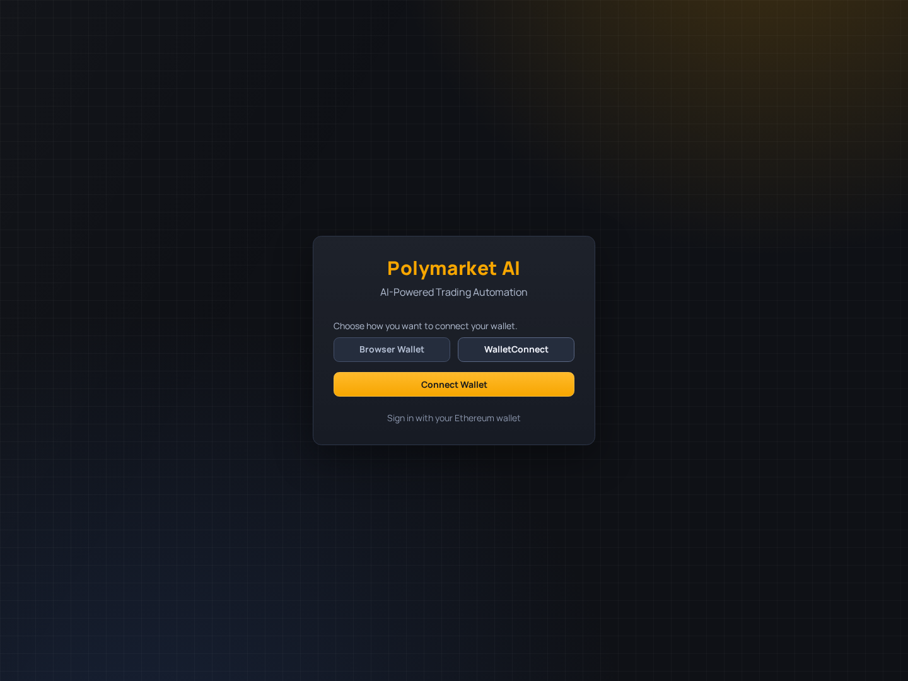

Choose **WalletConnect**, click **Connect Wallet**, and scan the pairing QR with
your wallet app. Then approve the connection and the separate sign-in signature.

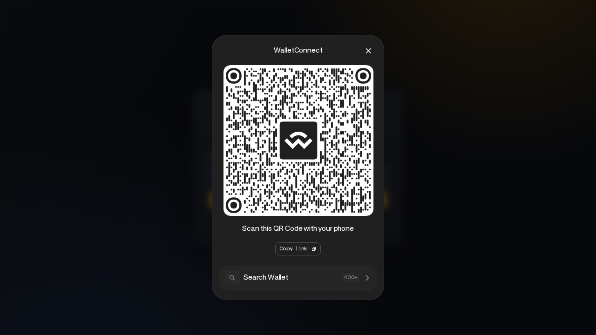

These screenshots come from the running application. The QR shown above is an
expired test pairing; generate a new QR in your own session.

Run `npm run test:walletconnect` from `frontend/` for browser regression tests
(success, rejection/retry, empty accounts, and missing configuration). The tests
replace the external SDK boundary and use an explicit fixture ID; they do not
prove the real relay accepts a project ID.

To check the real SDK and relay against the **production build**, set
`VITE_WALLETCONNECT_PROJECT_ID` in your environment and run:

```bash
WALLETCONNECT_LIVE_CANARY=1 npm run test:walletconnect
```

The live test requires a real 32-character project ID, checks a pairing QR and
successful project validation and a relay WebSocket handshake, and rejects browser security-policy violations;
it does not pair a wallet, sign a message, or submit a transaction. Add
`UPDATE_WALLET_SCREENSHOT=1` to refresh the QR screenshot. Use the same update
flag without the live flag to refresh the login screenshot. CI offers the real
test as the opt-in `walletconnect_live_canary` workflow-dispatch input, using
the repository Actions secret. In Reown, permit your deployed origin and local
test origin `http://127.0.0.1:5190` if you use an origin allowlist.

## Dashboard and notifications

Open **Dashboard** for balances, position counts, invested/current value, P&L,
positions, market discovery and the followed-trader feed. Review the execution-mode
badge; where allowed, **Switch to Paper** changes the account setting. Paper
balances/counters and live portfolio values represent different records.

Filter the following feed by trader or event type, and use **Refresh** to fetch
new observations. The bell opens the notification center; read an item, follow its
link, or mark notifications read. Notifications can include followed-trader
activity, redemption reminders and operational warnings. Configure delivery
channels separately in **Settings → Notifications**.

Risk-operation actions include rescoring, arbitrage scanning and opening the full
Ops Center. Treat these as monitoring/research operations; check their reported
result rather than assuming a completed trade or a flat portfolio.

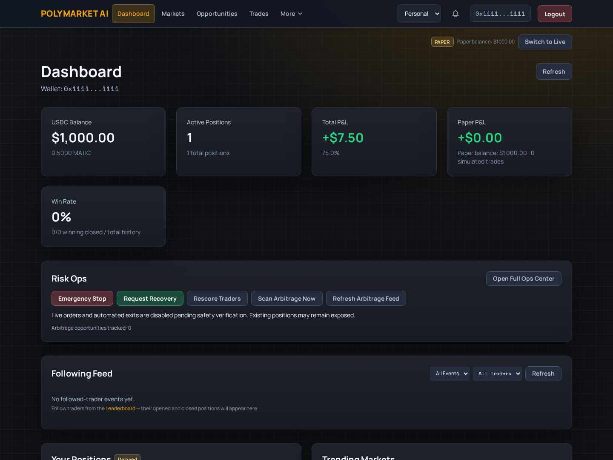


## Markets, watchlists and manual orders

Open **Markets** to browse events and outcomes. Use category buttons, search,
**Sort markets**, pagination/loading controls and the watchlist view to narrow the
board. Expand **Open market details** to inspect a grouped event. A market
watchlist is local browser research state; it does not buy an outcome or subscribe
a trading strategy.

To inspect order entry, choose a market’s YES/NO trade action. In the trade ticket,
check the market and outcome, BUY/SELL side, amount units, indicated price, quote
age and any size suggestion. A buy budget in USDC differs from a sell amount in
shares. Review the confirmation and any rejection; an indicative quote is not
proof of executable depth. Keyboard presets and suggestions do not submit an order
by themselves. Current live-order restrictions still apply.

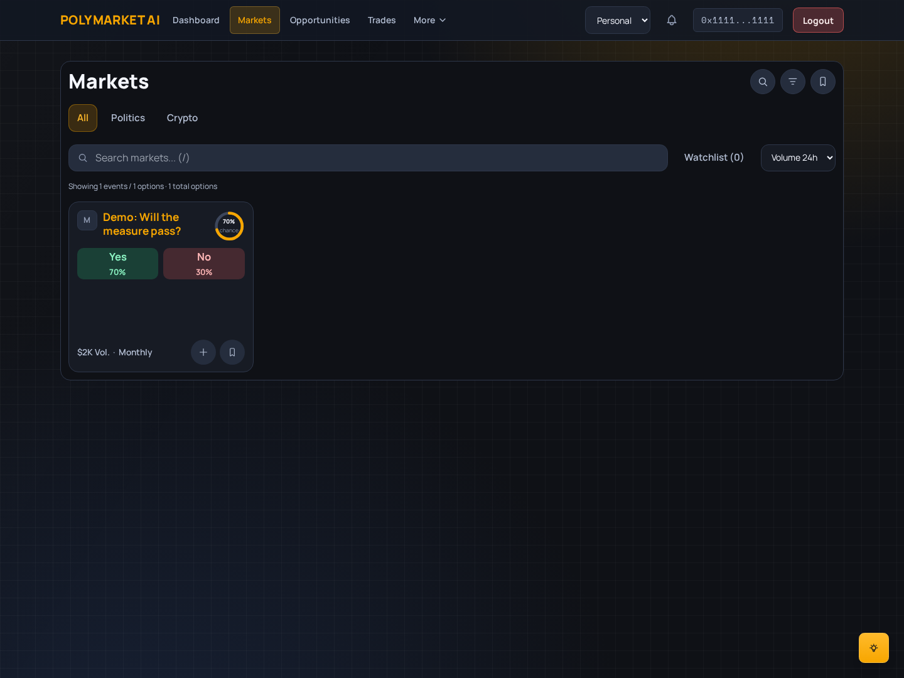

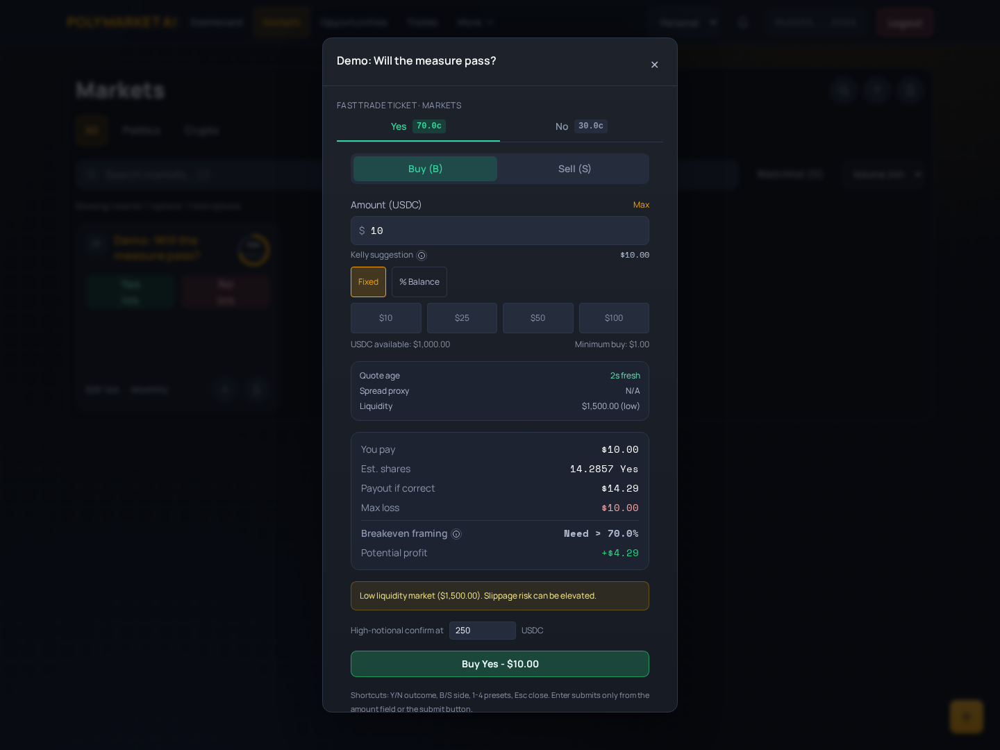

## Opportunities and market research

Open **Opportunities** for a market scan and its filters. Expand a market and
choose **Research market**. **AI Analysis** is the separate legacy analysis flow;
its link-supplied inputs are not a substitute for source-backed context.

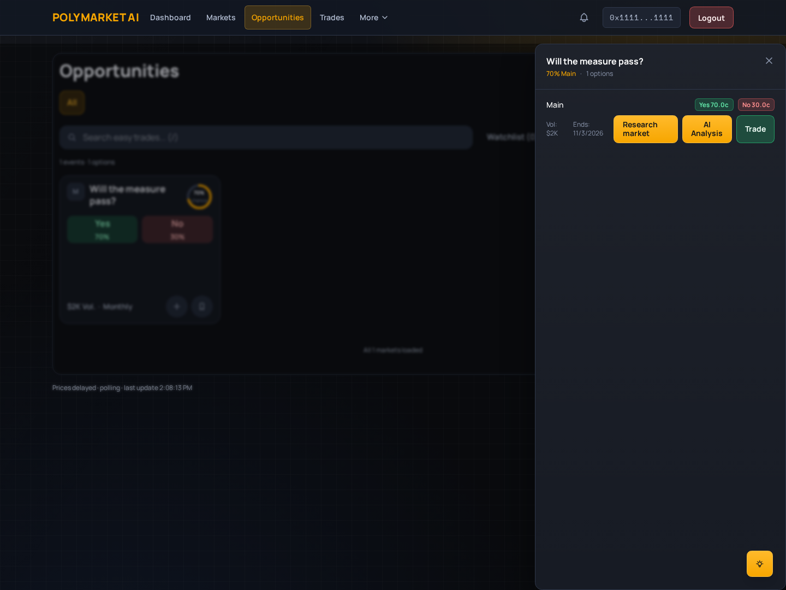

In the research view, check the question, outcome identities, source retrieval
clock and **What determines the outcome?**. Follow **Review original market
source** to inspect the venue. Expand **Source identity** to see the condition ID,
rule/token-mapping hash and captured snapshot identity. Missing prices and rules
remain unavailable. End-date metadata does not independently verify a settlement
cutoff or oracle, and token prices do not establish order-book depth.


Choose **Run Deep Dive** to request a structured evidence brief. Review supporting
and contradicting claims, source links, missing information and limits. A matched
quotation establishes attribution to captured text, not truth or entailment.
**Investigate further** is a research status; **Insufficient evidence** means the
inputs or output do not support a usable brief. Cancel an in-progress request or
use the retry action after a failure. AI provider access must be configured.


Under **Source observation history**, choose **Load observation history**. Set
**Received by (UTC, optional)** to inspect only observations captured by that time,
and expand an observation to compare original rules and hashes. Later revisions
do not overwrite earlier captures. History starts with this deployment’s captures;
it does not backfill order books or store private AI briefs.

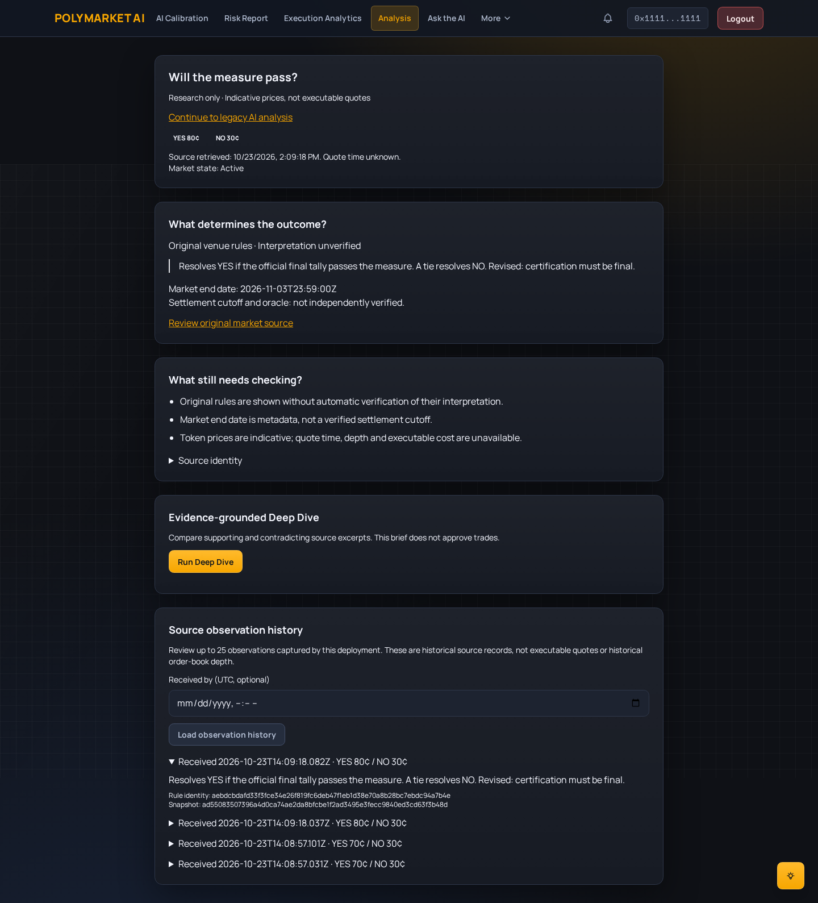

## Ask the AI and orchestration

Open **Ask the AI**, choose **Open palette**, or use **Ctrl/Cmd+K**. Enter a question,
use an example or a recent question, then choose **Ask**. Voice input depends on
browser support and microphone permission. Watch the plan steps and synthesis;
partial/error states must not be mistaken for a completed answer. **Escape** closes
the palette. Suggested action links lead to review pages; they do not approve or
place orders.

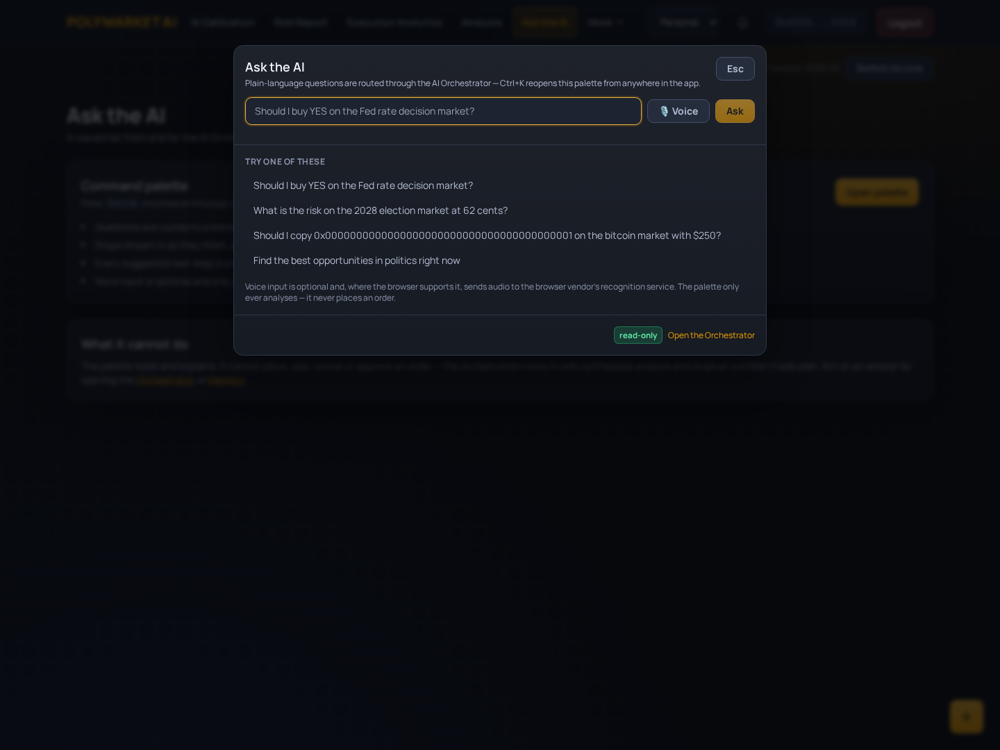

For an explicit plan, open **Orchestrator**:

1. Choose **Market Deep Dive**, **Opportunity Sweep**, or **Trader Diligence**.
2. Fill the displayed payload: market details, a JSON market list, or trader and
   proposed-position inputs, depending on the plan. Verify numbers and identities.
3. Start the plan, inspect each completed step and read the synthesis. Cancel or
   retry as needed; keep provider failures and incomplete steps visible.

The Orchestrator’s legacy research/risk/trade-plan workflow is distinct from the
source-attributed structured Deep Dive above. Generated plans remain review material.


## Leaderboard, trader research and collaboration

Open **Leaderboard** and choose the trading or **Forecasting accuracy** view.
Filter the board’s period/scope and open a trader to inspect available history,
positions and research actions. A displayed P&L or rank is not verified follower
profit or proof of trader skill. Check sample sizes, provenance and missing data.

Trading-follow controls and notification-follow controls serve different purposes:
one selects a trader for copying configuration, while the other subscribes to
activity. Following a public forecaster is also separate from copying trades.

In **Forecasting accuracy**, inspect Brier skill and resolved-sample counts. Use
the market condition-ID input to open its forecast panel where available. Submit
an explicit probability and visibility, and read market notes/consensus and
contributor context. Consensus is advisory, and private contributions are not a
substitute for publicly attributable evidence.


## Copy trading and follower simulation

Open **Copy Trading** to follow a wallet and review per-trader controls, sizing
choices, copy-trade history and evaluation reasons. Configure maximum size and
choose inherited settings, fixed amount, wallet-ratio or Kelly sizing where
available. Configure global limits in **Settings → Trading** and account-specific
limits in **Settings → Accounts**. A Kelly suggestion depends on its probability
and bankroll inputs; it is not a guarantee of profit or permission to trade.

The **Trader Watchlist (Illustrative)** view is a local research aid, separate from
server-side following, real executions and saved follower experiments. Simulation
results do not automatically enable live copying or update that watchlist.

For a reproducible research comparison, use **Simulate following a trader**:

1. Choose **Download synthetic example**, then load it with
   **Import frozen experiment JSON**. Replace it with your own frozen signals and
   bid/ask depth only after understanding the format.
2. Check trader wallet, follow/end timestamps with timezones, funding, per-signal
   USDC notional and fees. A blank fee means unknown; zero is an explicit assumption.
   Delay scenarios come from the imported JSON.
3. Choose **Run and save simulation** and compare each delay’s NAV, net P&L, fees
   and cash against the no-copy baseline.
4. Expand a delay’s **signal outcomes and accounting journal**. Check partial fills,
   nonfills and missing marks, and use **Download journal** for the event list.
5. Reload and open **Saved experiments in this account** to reopen an archived run.

Missing eligible depth or fees prevent fills. Missing fresh final marks make open
position NAV/P&L **Unknown**. Imported inputs and outputs are unverified research.
Follower replay requires `FOLLOWER_REPLAY_ENABLED=true` after migrations.


For native evidence, an administrator must also enable `NATIVE_CAPTURE_ENABLED`.
Choose **Use native captured data**, enter a wallet/window/fee assumption, then
**Capture trader and native books now** and **Run and save simulation**. Inspect
**Captured source manifest**, its SHA256 and **Download source manifest**.

A capture reads up to 50 recent trade records across five markets and joins native
Gamma/CLOB identities and depth. It starts at receipt time and does not reconstruct
earlier books. Capture later snapshots for delayed scenarios. Trades before follow
start are excluded; repeated snapshots do not prove replenishment. Closed, paused
or conflicting markets cannot produce a native replay here. Fees and fills remain
modeled, and continuous tracking and native settlement are not provided by this flow.

## Positions, trade history and protection

Open **Trades** to inspect recorded history. Use side/status filters and refresh;
review outcome shares, price, dollar cost, fees, timestamps and transaction state.
A submitted order and a confirmed fill are different states.

Switch to **Your Positions** for holdings. Inspect entry/current prices and
unrealized P&L, then open **Cash Out**, **Stop Loss**, or **Take Profit** for the
relevant position. In protection dialogs, review the token, share amount and
trigger price before saving or cancelling. Protection orders are monitored
instructions, not a guarantee of a fill at the trigger price. Current automated
exit restrictions still apply; an emergency stop does not prove positions closed.

The **Inverse Position Bot** panel controls monitoring, evaluation and sizing
for a position. Check its enable state, current recommendation, confidence,
explanation, last evaluation and any error. Use global inverse defaults in
**Settings → Trading** and review any per-position override before enabling it.

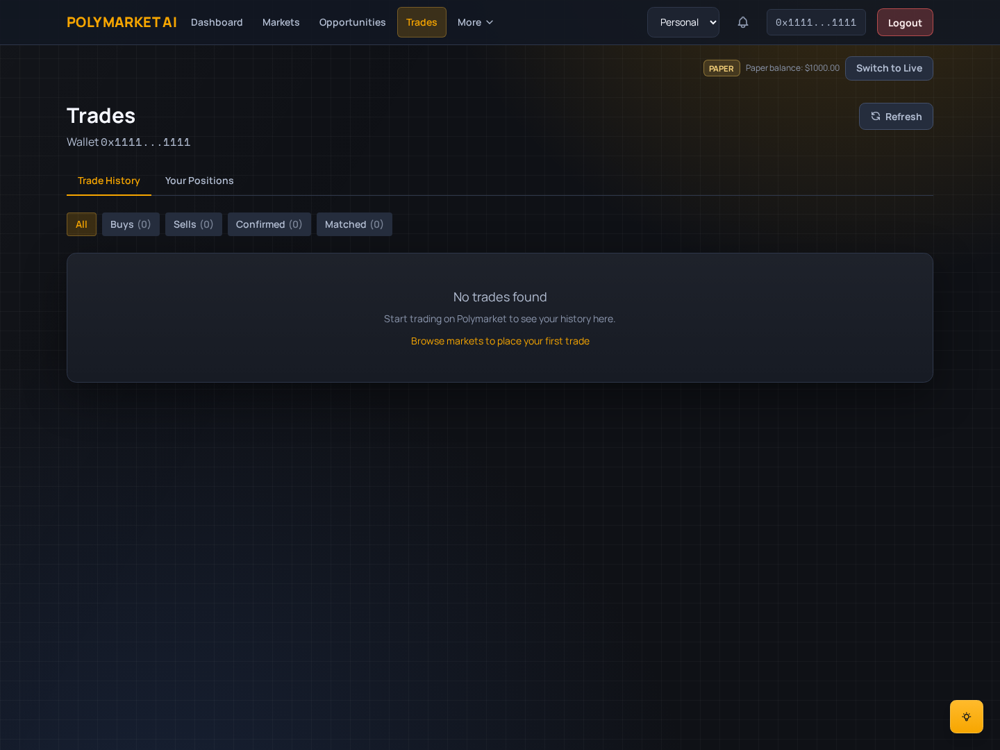

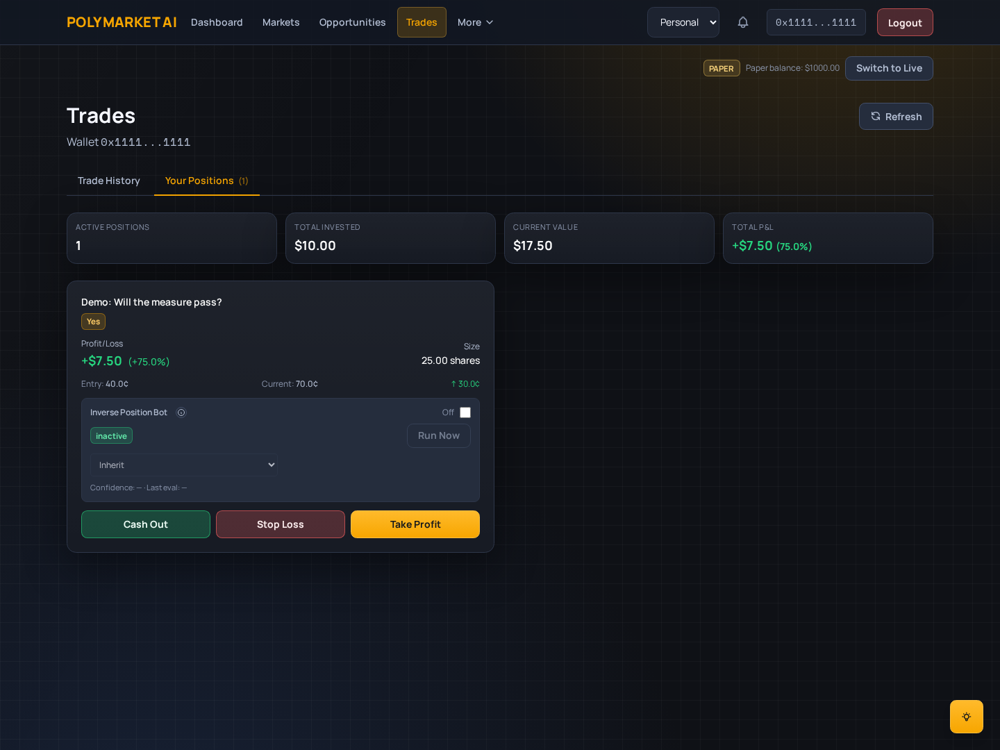

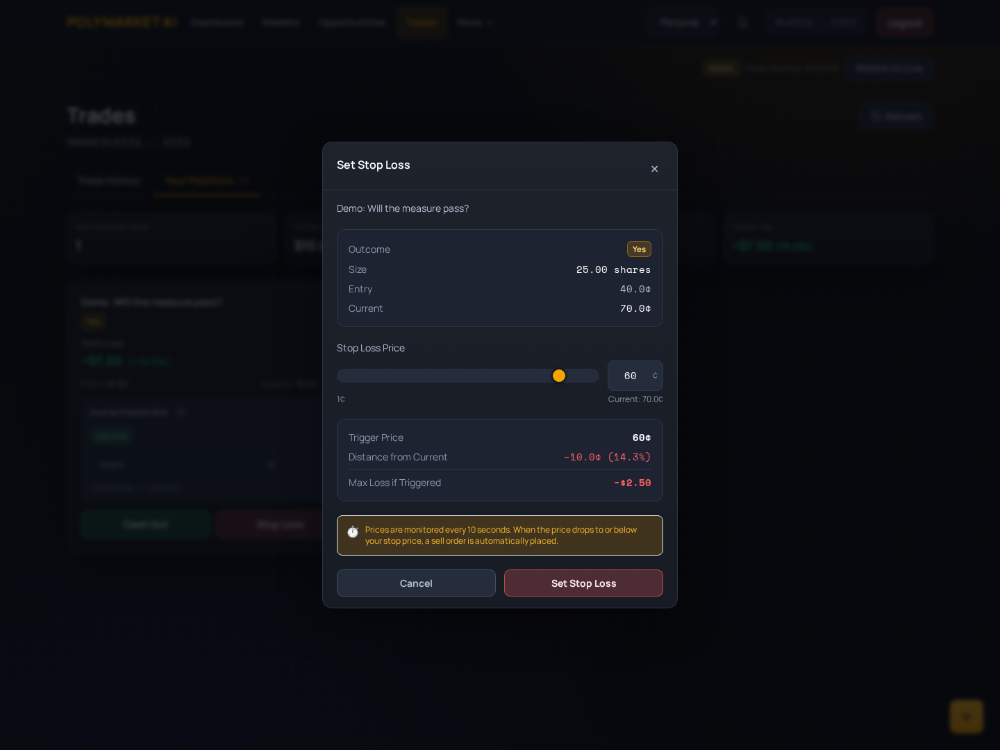

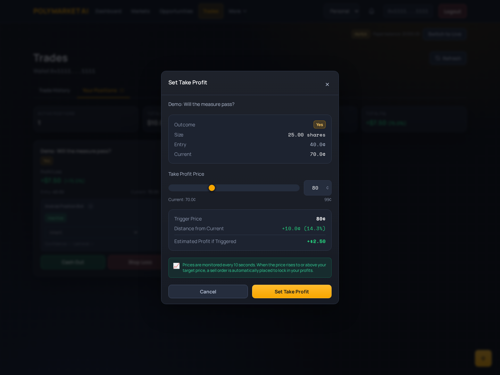


## Market making

Open **Market Making** and choose **+ New Config**. Enter the condition and YES/NO
token IDs, choose BANDS or AMM, and review spread, size/liquidity, price bounds,
collateral and sync interval. Save the configuration before considering Start,
Stop, Sync or enable/disable actions. Check the selected account, paper/live state
and current server restrictions; saving a definition does not establish a fill.

For paper configurations, **Inspect paper quote intents** shows desired quote
definitions. `UNFILLED_DATA_MISSING` means qualifying flow/queue evidence is absent;
`WITHDRAWN` means the definition was removed. These are not resting orders,
reserved inventory or executions. Unchanged paper syncs retain their identities
and add no executed volume. Historical paper counters remain unverified.

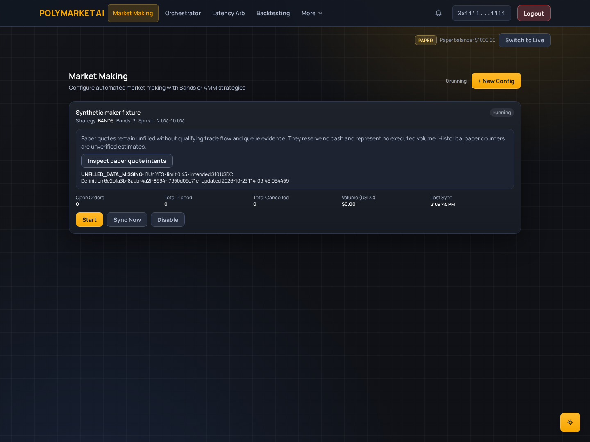


## Backtesting

Open **Backtesting**, choose **+ New Backtest**, select a strategy and date range,
and fill its parameters. Copy-trade replay and indicator strategies have different
input needs; inspect the available strategy description rather than reusing
parameters blindly. Submit the research job and wait for its pending/running state
to become completed or failed.

Open a previous run to inspect its assumptions, trade log and reported metrics;
delete only runs you no longer need. Compare like-for-like windows and costs.
Legacy backtests are not equivalent to the captured follower-journal experiments,
and a reported Sharpe, win rate or P&L is not automatically independently verified.

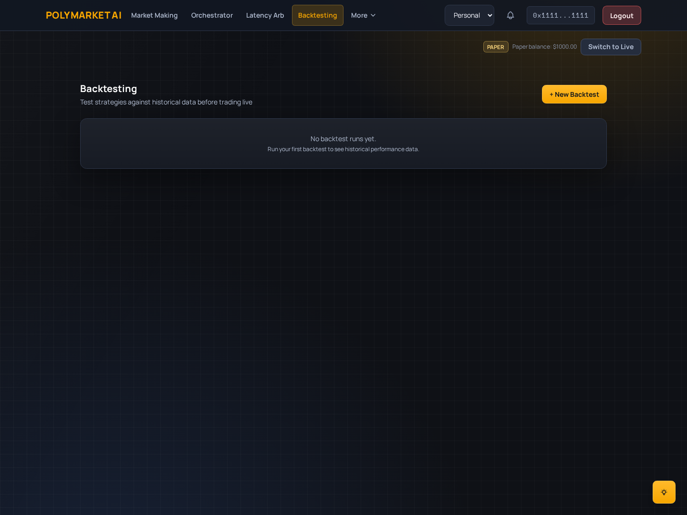


## Latency arbitrage

Open **Latency Arb** for the live edge board, engine status and trade log. Review
symbols and window lengths, model-vs-market probabilities, edge thresholds,
remaining time and latency. Configuration includes maximum notional, daily loss
limit, late-entry policy and opportunity alerts.

Configure conservatively in paper mode where supported and inspect engine errors
and modeled-fill assumptions. An apparent edge is a model comparison; it does not
prove an executable quote, final settlement or realized profit. Current live-order
restrictions remain in force.


## News and whale monitoring

Open **News** to browse generated market articles. Use **Refresh Feed** to refresh
available coverage, or **Generate Article** with the required market inputs. Read
the summary, underlying context, tags, generation time and provider/model where
shown. Generation needs the configured AI/research services; generated narrative
is research and should be checked against original reporting.


Open **Whales** to review large-wallet activity. Filter by event type or side; use the separate wallet watchlist to choose
addresses to monitor. Set **Min notional (USD)** and the **Leaderboard whale set**,
then choose **Save Settings**. **Auto-copy whale trades** is a separate strategy
control, not a requirement for monitoring. Transfers, splits/merges and redemptions
have different meanings from a directional buy/sell; do not equate every event
with conviction or profit.


## Risk, execution and forecast analytics

**Risk Report** shows portfolio concentration, value, loss bounds, correlated
clusters and upcoming catalysts, plus a narrative where available. Refresh after
holdings change and distinguish calculated metrics from AI interpretation. Missing
inputs limit the report; it does not guarantee a maximum loss or a timely exit.


**Execution Analytics** compares submissions/fills, slippage, fees, win rate,
strategy attribution, edge-score inputs and per-trade details. Choose a time window
and strategy, inspect data-quality exclusions and compare expected with actual
execution. Missing fee/expected-price data affects interpretation; empty graphs
mean no eligible recorded executions, not perfect execution.

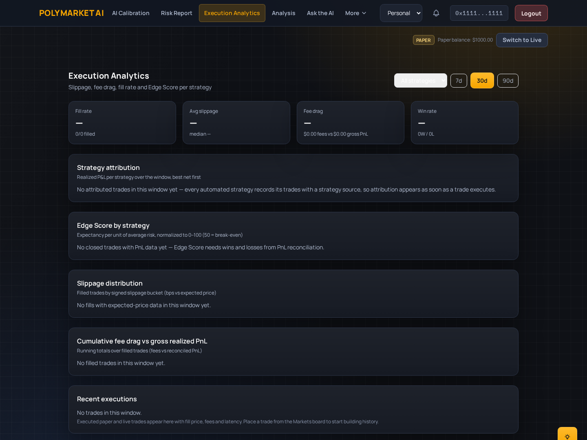

**AI Calibration** measures recorded probability forecasts against eligible final
outcomes. Choose the time window and scope, inspect sample/resolved
counts, Mean Brier, Brier skill, Avg edge, reliability buckets and model/task/prompt breakdowns.
Review exclusions and unresolved rows before comparing models. The 0.25 Brier
baseline is a reference for binary forecasts, not a promised return.

Forecast rows can expose verdict feedback where supported. Administrators also
review drift and create/manage A/B experiments: define control/variant settings,
compare eligible resolved samples and pause/retire an experiment when appropriate.
An experiment result with insufficient samples should not be treated as a winner.

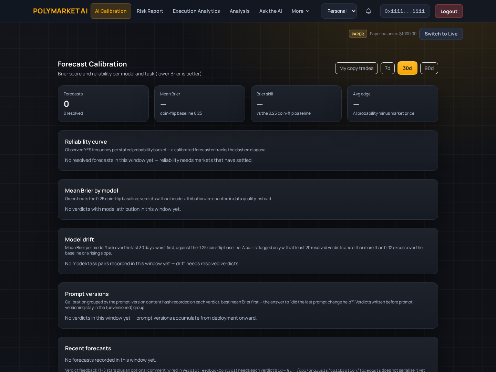

## Cross-venue signals

Open **Venues** to inspect adapter health, cached market rows and cross-venue or
intra-Polymarket comparisons. Search/filter and review both questions, token/rule
semantics, horizons, liquidity and fetch times before treating rows as comparable.
Play-money sources must remain distinct from real-money venues.

Adapters may be disabled or have no captured data. These rows are read-only
signals: matching titles or price differences do not establish equivalent payouts,
executable prices or a risk-free arbitrage. This page does not submit multi-venue
orders.


## Accounts, settings and integrations

**Settings → Profile:** edit display name/contact details or avatar and save your
profile. Select a personal AI provider/model and choose **Save AI Preferences**.
The deployment must have usable provider access; selecting a name does not install
or authenticate that provider.

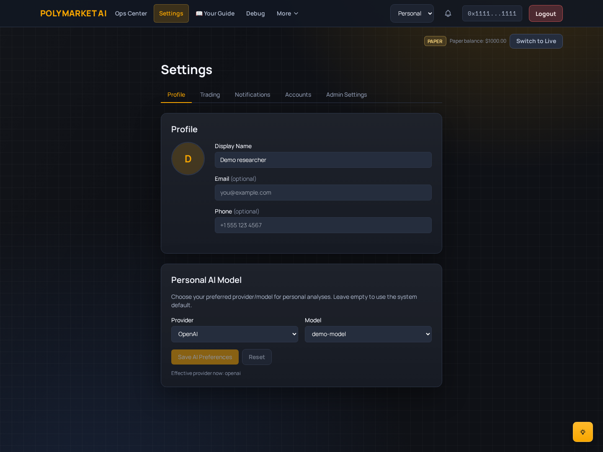

**Settings → Trading:** manage the separate encrypted trading key, copy-trading
mode/sizing/limits and inverse-bot defaults. Login signatures do not supply an
execution key. Review daily loss and maximum-position limits, sizing mode and
AI-approval requirements. Account drawdown, Kelly fraction, paper balance and
simulation controls are under **Accounts**. Disconnecting a key does not prove all existing positions are closed.

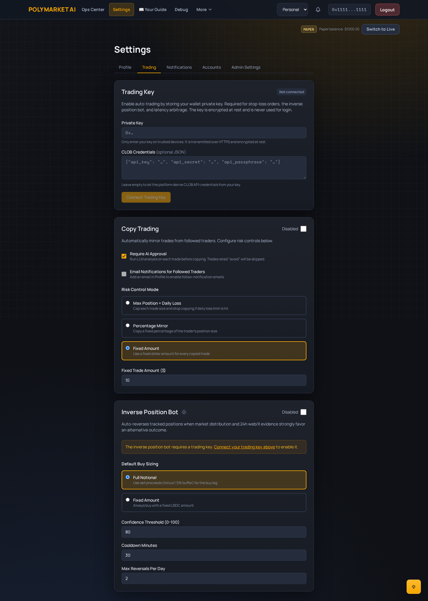

**Settings → Notifications:** add a supported channel, enter its channel-specific
details, save it and optionally send a test alert. Configure event routing and
**Save Preferences**; configure daily-digest preferences separately. Test alerts
send a real message in a configured deployment. This guide’s capture does not send
an alert or contain a webhook credential.

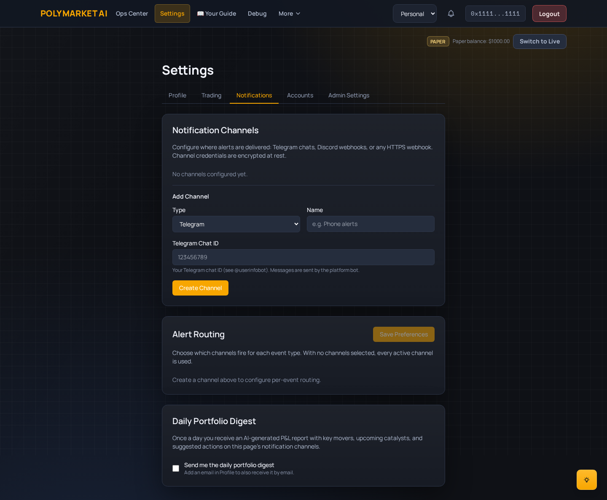

**Settings → Accounts:** inspect/create/rename accounts where the deployment and
plan allow them. Select an account before editing its AI, sizing and risk settings.
The active account scopes account-aware histories and experiments; separate local
watchlists and legacy records are not automatically migrated between accounts.

Choose the account’s **Settings** button to review its paper balance, daily loss,
maximum position, drawdown, Kelly fraction, simulation mode and AI approval.
The personal account shares its settings row with the Trading tab.


The same tab contains **API Keys** and **Subscription**:

- Give an API key a name, choose read/trade scope, optional account scope and expiry,
  and store its one-time secret securely when creating it. Review last-use/expiry
  and revoke keys you no longer need. Read scope does not grant trading, and trade
  scope does not bypass current server barriers. These keys authenticate the
  external REST API; supported WebSocket position/fill streams are a separate
  integration surface.
- Inspect the current plan, capability/quota usage and available upgrades. Checkout
  and subscription management require billing configuration and may require an
  email address. A pending checkout is not a completed plan upgrade. Account and
  strategy features remain subject to their plan and deployment gates.

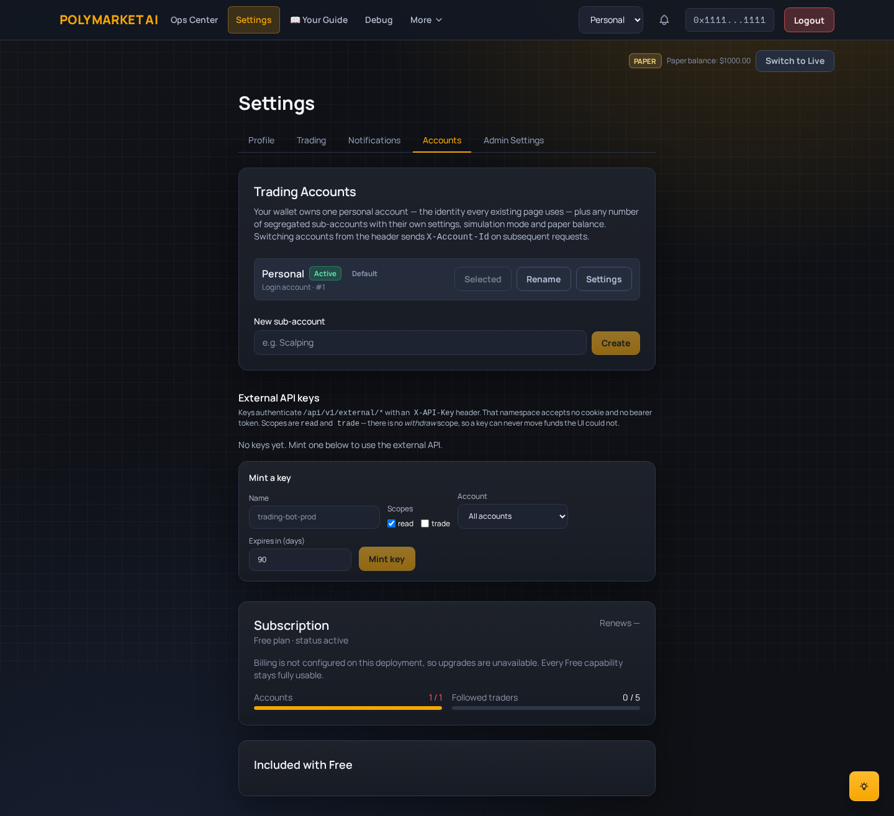

## Operations and administration

Open **Ops Center** for risk controls, emergency status, arbitrage scans, category
research and optional Binance smart-money/social/trending/inflow panels. Check
whether a feed is configured and its update time. A disabled feed or empty ranking
is missing information, not a neutral market signal.

Use **Emergency Stop** when you intend to pause automation, then inspect the
operation’s durable status, cancellation confirmations, still-open orders and
unresolved positions. Requested cancellations/exits are different from confirmed
ones. Recovery requests and operator approval, where available, do not bypass a
locked execution barrier. **Rescore Traders** and scan actions produce research
outputs, not live execution approval.

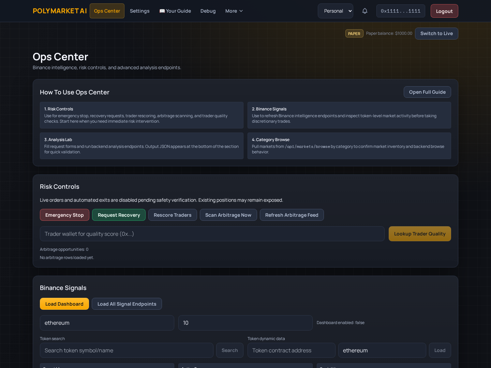

Administrators use **Settings → Admin Settings** to inspect provider health,
set system defaults and review per-user model overrides. Distinguish a provider
being configured from it being healthy. Per-user and account preferences can affect
which backend/model is actually used.


Administrators can also open **Debug** to inspect service health/uptime, endpoint
statistics and filterable request logs. Use level, method, path and limit controls
to narrow a diagnostic investigation; clearing logs removes diagnostic records.
Diagnostic access is separate from ordinary workspace access.

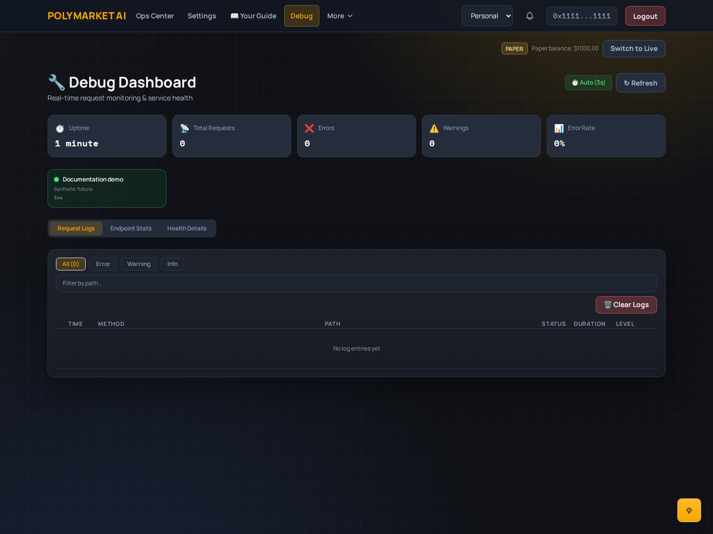

## In-app help

Open **Your Guide** (`/guide`) for searchable help sections and the interactive
tour. Expand the relevant feature section and use the tour to locate controls.
The README’s current implementation limits above take precedence over older
in-app explanatory examples that imply verified performance or unrestricted live
execution.

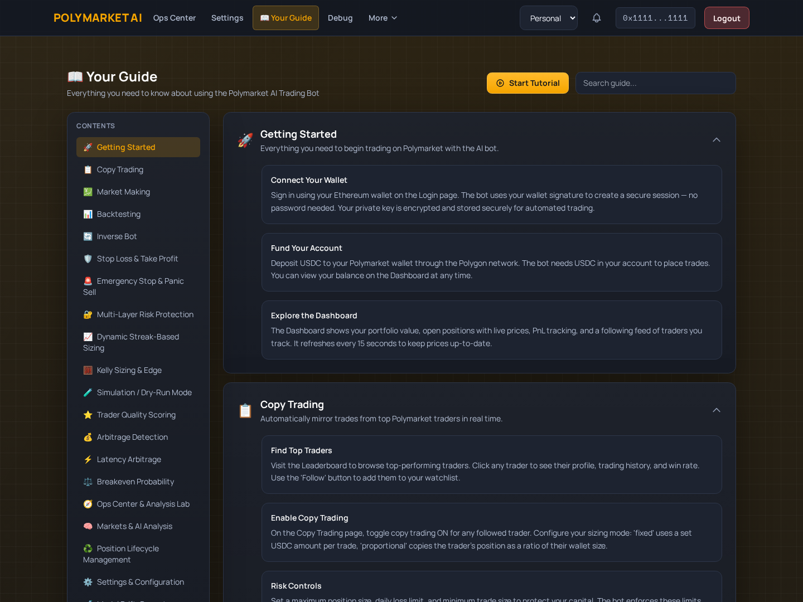

## Troubleshooting a workflow

| What you see | What to check |
| --- | --- |
| Sign-in prompt or missing private pages | Wallet session and selected account; reconnect if the session expired |
| Provider error, incomplete answer or insufficient evidence | Server provider configuration, research sources, and the displayed missing-input/error details |
| Unavailable native capture or follower replay | Migrations and the deployment’s capture/replay flags; a retained archive is separate from new collection |
| Unknown NAV, unfilled quotes or empty analytics | Eligible books, explicit fees, fresh marks and recorded/verified samples; do not replace missing data with zero |
| Disabled strategy, key, account or upgrade action | Execution restrictions, permissions, feature flags, plan capabilities and quotas |
| Halt reported but exposure remains | Confirmed cancellation/exit counts, still-open orders and unresolved positions, then operator recovery requirements |

<details>
<summary>Refresh all guide screenshots (contributors)</summary>

The opt-in capture config renders the real React application at a 1440 × 1080
viewport. `capture-user-guide.spec.ts` exercises source research/history and
follower/maker workflows against the disposable real API. `capture-app-guide.spec.ts`
uses the explicit demo responses in `user-guide-fixtures.ts` for the wider app,
so captures need no production wallet, trading key, paid provider or billing
account. The fixtures illustrate UI states; they are not evidence that optional
external integrations or live execution are operational.

From the repository root:

```bash
uv sync --project backend --frozen
cd frontend
npm ci
npx playwright install chromium
npx playwright test --config playwright.user-guide.config.ts
```

Ports 8002 and 5187 must be free. The config starts/stops its own backend and Vite
servers. On supported Linux hosts, use `npx playwright install --with-deps chromium`
if browser libraries are missing. The capture scripts write PNGs under
`images/`; inspect them with the instructions before committing
a refresh. Normal regression CI does not rewrite these documentation assets.

</details>
