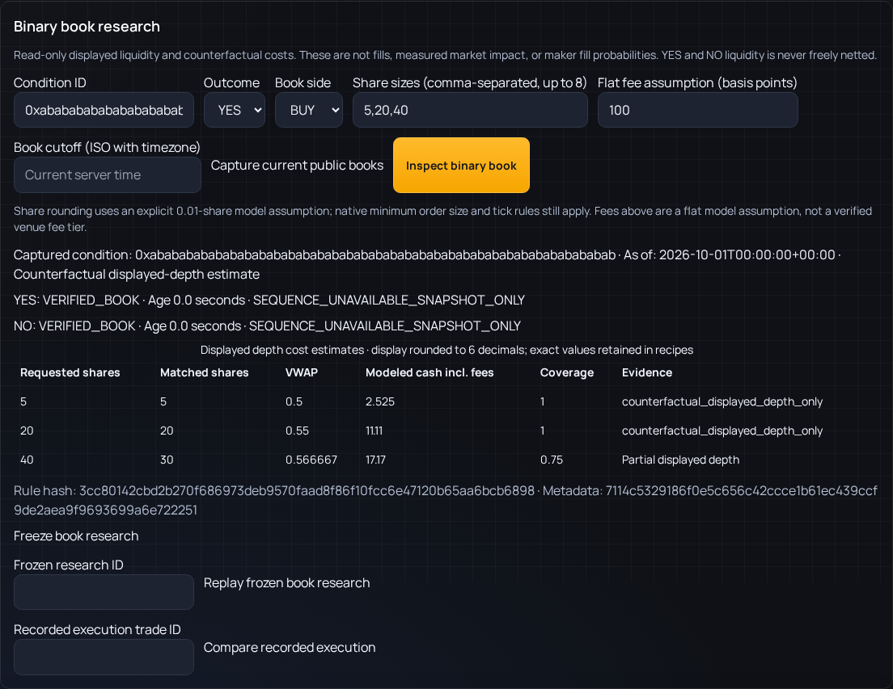

# Binary book research (#18)

Open **Backtesting → Binary book research**. Enter the native condition ID, choose
YES/NO and BUY/SELL, and enter up to eight share sizes. Explicitly enter a flat fee
assumption in basis points to calculate costs; leaving it blank preserves unknown
fees. The 0.01-share rounding assumption is modeled, not a verified venue lot rule.

Choose **Capture current public books** to fetch paired CLOB/Gamma metadata and
both token books using the existing native client, then **Inspect binary book**.
Capture does not backfill historical books. An optional ISO cutoff requires a
timezone and only sees receipts available by that cutoff. New captures cannot
repair a historical window by being assigned an old source timestamp.

Read the data grade and reasons before the cost table. VERIFIED_BOOK validates a
captured point snapshot, not continuous history, queue position or execution.
PARTIAL, STALE and NO_HISTORY abstain from usable costs. The size table shows
matched shares, partial coverage, displayed-depth VWAP and counterfactual fee-
inclusive cash. None of those values is a confirmed fill or measured market impact.
YES and NO liquidity is not freely netted.

**Freeze book research** saves the exact inspected receipt IDs and private query.
Copy its research ID to **Replay frozen book research** to verify the same result
later. Recipes/results are scoped to the selected account; public source receipts
are shared evidence. Invalid or foreign account headers never fall back to another
account. Modified/missing evidence or changed result hashes fail replay explicitly.

For a frozen run, enter an existing **Recorded execution trade ID** to compare
against the account's settled gateway record. Pending/unverified fills, another
account's trade, mismatched token/side/condition or an expired pre-order quote
cannot produce a comparison. The reported gross VWAP difference is observational:
it includes latency and market movement and is not causal price impact. Legacy
float notional precision and unknown observed fees remain explicit. No new order
is submitted to create a benchmark sample.

*Deterministic public-provider fixtures in the real application UI; the displayed
costs are modeled and do not represent live fills.*

## Setup, monitoring and rollback

This PR is stacked on #98 and its source archive. Apply migrations in dependency
order, then enable `BINARY_BOOK_RESEARCH_ENABLED=true`. Collection also requires
`OBSERVATION_ARCHIVE_ENABLED=true` and `NATIVE_CAPTURE_ENABLED=true`; all default
off. Configure pinned archive tokens as described in the market-observation guide.

Native WebSocket deltas do not currently establish documented consecutive sequence
semantics. Gaps, tick changes and unverifiable continuity request REST resnapshot.
Automatic jobs are public/read-only, limited to subscribed conditions, two active
jobs per manager and one attempt per condition per minute. Each has a 25-second
budget; shutdown cancels them. Manual capture is rate limited. Monitor structured
resnapshot status logs, capture failures, book reasons, source IDs, age and expiry.

Turn off the book flag and restart/stop collectors to disable the new workflow.
Existing order placement/cancellation, risk limits, durable intent IDs and emergency
halt authority are unchanged. Downgrading `20261027_0035_book_research` drops only
private research recipes; export them first. Public pinned source evidence and
legacy financial data remain. Rebase migrations if earlier pending PRs merge first.

## Research tooling and contracts

Authenticated read APIs and the `binary_book` Research MCP tool expose structured
source lineage and abstention reasons. The tool is GET-only, uncached and bounded;
unavailable authorization/provider data becomes an explicit abstention. Shared
Analysis/Research clients can invoke `binary_book_research`; orchestration can
receive compact server-owned context when the flag is enabled. The maker-specific
GET diagnostic proves configuration/token ownership without placing quotes.

`GET /api/microstructure/schema` publishes versioned typed input/output contracts.
See [the standalone skill](skills/prediction-market-microstructure/SKILL.md) for
algorithm details, examples, scope, references and future shared-package mapping.
Its evidence registry classifies this as an **implemented detector**. Live fill
calibration is unavailable without independently reviewed observed executions.

## Acceptance and validation

| Acceptance | Evidence |
| --- | --- |
| Crossed/empty/stale/halted/no-history books abstain | Pure replay and native adapter regressions; browser stale/missing-fee scenario. |
| Sequence gaps, reordered/ambiguous deltas and reconnects cannot create usable depth | Pure sequence/connection fixtures, native unknown-sequence regression, bounded resnapshot/shutdown test and browser resnapshot scenario. |
| Token/condition/rule identity and complement inequalities | Paired CLOB/Gamma metadata checks, wrong-token replay and maker configuration guard; complement warnings never authorize netting. |
| Size curves consume only displayed levels and handle partial coverage | Golden sorted-depth fixtures, size/budget boundary sweep, fee/rounding and deterministic Decimal-context regressions. |
| No unobserved fill-probability or measured-impact claim | Null measured-impact/probability fields, default unavailable queue policy and patched SDK create/post regression. No money-path integration. |
| Snapshot IDs and saved recipes reproduce quotes without future leakage | Native HTTP → archive → model → private freeze/replay; tamper rejection, source changes, cutoff/selected-ID isolation and browser replay. |
| Migration/concurrency/security/CI | PostgreSQL concurrent account freezes, process-exit rollback, bootstrap upgrade/downgrade/re-upgrade preserving source/users; account isolation and agent-tool transport tests. |

The shadow report compares the existing maker read helper's first-level assumption
with sorted depth walking on an explicitly synthetic book. It records no observed
live fill sample, no realized profitability and no promotion to production. Human
and independent-replication checklists are in the skill document.
