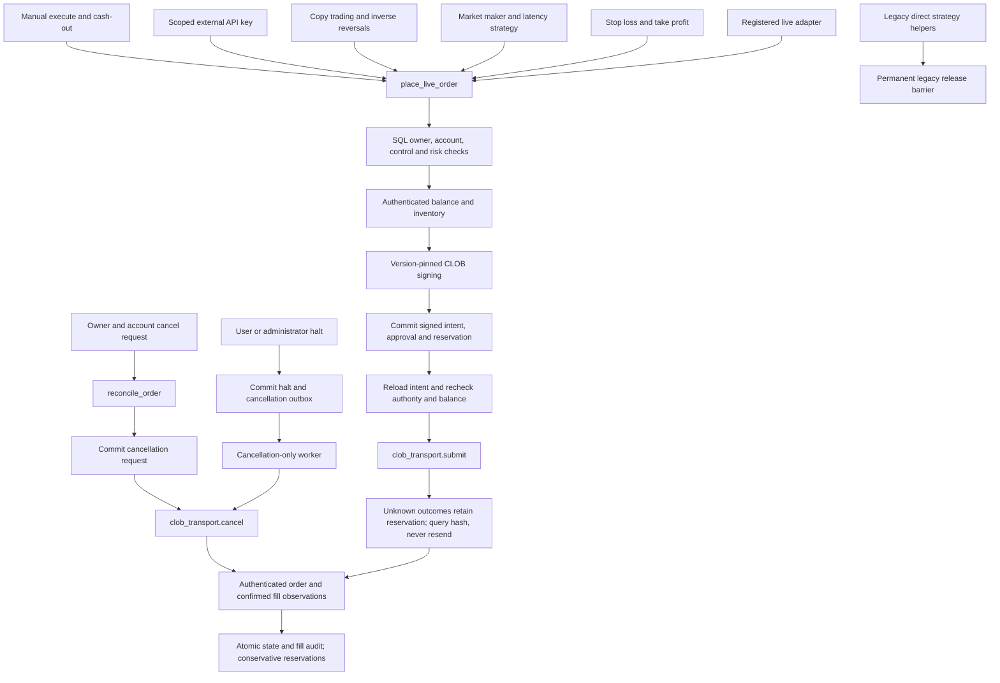

# Durable execution recovery (#26)

The gateway records a signed order hash and cash reservation before submission.
The recovery changes enforce the following invariants without enabling live funds.

## Evidence and accounting

Authenticated observations must match the persisted signed quantity and order hash.
When supplied, token and side must also match. Matched quantity cannot decrease;
a cancelled or filled order cannot reopen. A later cancellation observation can
increase matched shares and the associated principal reservation. Cancellation
reserves round upwards at the database's twelve-decimal precision.

Contradictory acknowledgements remain unknown even when they include an error.
A conflicting observation retains the prior state and confirmed fill watermarks,
restores the full signed BUY principal reservation, and records
`reconciliation_required=true`. That flag blocks further wallet orders and
activation. The bounded recovery worker revisits flagged records, including
already executed trades. Consistent authenticated evidence clears the flag;
there is no operator override that fabricates reconciliation.

Repeated reads of unchanged evidence create no economic effects or duplicate
transition events. Missing confirmed fill evidence cannot erase a confirmed trade.
Conflicting duplicate fill IDs, malformed values, over-limit prices and unknown
execution timestamps cannot establish execution. Per-ID receipt reads use only one
page and stop after a ten-second receipt-pass budget (plus any in-flight SDK
request timeout), rather than draining an unbounded pagination chain. Exact confirmed notional and
quantity are retained in the order's versioned JSON response. Confirmed trade identities must form an
append-only set; each new fill gets one transactional `order_fill_confirmed` audit
record including its transaction reference and exact quantities. Existing float-based
trade fields remain compatibility projections. No fee or realized P&L is inferred.

Open BUY reservations are deducted conservatively from authenticated wallet balance
across accounts. Partially filled orders retain their full commitment while open;
this may over-reserve when the venue already deducts locked or spent funds. It
must not overstate buying power. Filled principal continues to consume configured
risk budgets; this work does not implement a reusable cash/P&L ledger.

## Transactions and audit

`order_intent_created` records the fingerprint, signed amounts, limit, order type,
condition/token, account, strategy and bounded risk-approval snapshot. `order_state_changed` records before/after
state, reservation, fill watermark and reconciliation status in `AppEvent` on the
same transaction as the state change. `order_cancel_requested` commits before the
exchange cancellation; an ambiguous cancellation acknowledgement is followed by an
authenticated order read. Missing or failed audit persistence prevents the remote
mutation. Audit records contain no key, API credentials or signed bearer payload.

A crash before the intent commit leaves no order. A crash after the exchange send
leaves the committed intent `SUBMITTING` with its reservation. Replaying that key
returns the existing intent; recovery queries its signed hash and never resends it.
A database failure after a successful send follows the same recovery policy.

Manual execute/cash-out and order list/reconcile/cancel endpoints validate an
explicit `X-Account-Id`. Unknown/foreign/malformed accounts cannot fall back to a
different account, and a same-owner account cannot cancel another account's order.
Legacy wallet-only intents remain accessible under the owner's personal account,
never under a subaccount. Calls without an account header retain the existing
wallet-level behavior. The
worker and emergency halt deliberately operate across the owned wallet. The unused
raw-key maker cancellation helpers were removed; owned maker cancellation uses
the gateway and emergency cancellation uses its existing durable halt outbox.

## Verification and rollout

No migration is necessary: the implementation uses existing order JSON and
append-only `AppEvent` storage. Existing records acquire their watermark from the
next verified observation; existing settled trades also retain their previous fill
quantity as a lower bound. Old history is not reconstructed or relabelled.

Run from `backend/`:

```sh
uv run --frozen pytest --no-cov tests/test_live_gateway.py tests/test_live_gateway_recovery.py tests/test_clob_transport.py tests/security/test_live_execution_freeze.py
TEST_DATABASE_URL=postgresql:///disposable_test_database uv run --frozen pytest --no-cov tests/integration/test_live_gateway_postgres.py tests/integration/test_trading_halt_postgres.py
```

The PostgreSQL tests use separate schemas and fake exchange transport. They cover
concurrent idempotency, competing budgets, hard process death on both sides of the
commit boundary, cancellation audit visibility, and halt acknowledgement during an
in-flight order. CI requires the new PostgreSQL tests. No funded wallet, real
signature or actual venue mutation is used by these tests.

Existing master/strategy defaults in Settings, example environments and Compose
are preserved. Users retain the existing paper/live selection. The gateway still
requires account authorization, activation, risk budgets and non-simulation mode;
choosing paper never invokes the live transport. The legacy submission barrier
remains in place. Monitor reconciliation flags, `order_observation_rejected`,
`order_cancel_unknown`, unresolved orders and recovery-worker failures. Do not clear
a halt merely because a timeout elapsed or an order lookup returned 404.

For rollback, first disable live flags and retain the database and audit log. Older
code does not enforce the reconciliation flag, so do not run an older live gateway
against quarantined records. Reconcile through the reviewed version before any
separate release decision.

## Separate financial and release work

The configured budgets conservatively bound principal; they are not reconciled
live cash or a complete portfolio ledger. #24, #56 and #3 own settlement,
redemption, fees and complete accounting/attribution, including external wallet
activity. These remain separate from CLOB gateway acceptance. No profitability,
independently verified production venue history or financial reconciliation is
claimed by the gateway tests.

## Issue #26 acceptance review

The current issue predates the existing live adapter. This review verifies the
CLOB execution boundary and its conservative principal reservations, not a new
production release or the separate settlement/P&L features.

| Issue acceptance criterion | Implementation and verification |
| --- | --- |
| Every venue mutation has authorization and centralized durable recording | Normal submissions use `place_live_order`: SQL owner/control locks, wallet/account risk checks, fresh authenticated balance, stable key and signed hash, committed intent and risk snapshot precede POST. Normal cancellation uses `reconcile_order`; emergency cancellation uses the committed `EmergencyHaltOperation` outbox. AST mutation inventories and real legacy-gate tests fence the old direct SDK paths. |
| Negative tests cover unknown ACK, restart, duplicate/partial fills, cancel race, accounts, replayed keys and circuit breaker | `test_live_gateway.py`, `test_live_gateway_recovery.py`, `test_issue26_acceptance.py`, `test_clob_transport.py` and the PostgreSQL gateway/halt suites exercise these cases. Additional controls cover 429/500/expired credentials, before-commit/after-send process death, Redis outage, revoked follow/AI permission, signing-time balance change, cached sender projection and late terminal fills. |
| Existing legacy release barrier remains effective | `test_live_execution_freeze.py` exercises the actual barrier with both enabled and disabled flags and patches the SDK constructors to prove rejection before signing. No change is made to `live_trading_policy.py`. |
| Completing the issue activates no new live path or actual trade | Master/strategy settings, Compose and example environments are unchanged. Paper/simulation cannot call the live transport. All fault tests use disposable databases and fake venue transport; actual signature tests use only the existing offline fixture key. No funded transaction is part of acceptance. |

The committed intent includes versioned wallet/account budget approvals, prior
reservations and window boundaries, authenticated available balance and receipt
time, venue/chain, signed quantities/hash, expiration policy, deadline, and a
source-evidence digest when provided. Audit payloads exceeding the log's bound
fail closed rather than silently truncating approval evidence. Final authorization
and balance are rechecked after the sender reacquires locks. Copy grants are
row-locked through the send, and the master/strategy flags and quote deadline are
checked again after balance I/O, immediately before submission. An intent changed or
quarantined by a recovery worker between transactions is reloaded and never sent
from the stale cached projection.

The recovery pass reserves up to 100 slots for uncertain/pending orders plus 20
separate round-robin slots for terminal observations. Late fills/corrections are
therefore still observed after an earlier confirmation, without terminal history
taking away the pending-order recovery slots. Terminal rollback or replaced fill
identity quarantines the wallet rather than deleting recorded execution.

### Mutation call graph



Requested/risk-approved/signed preparation is represented by the immutable intent
and approval payload. The compatible order projection uses `SUBMITTING` for the
persisted pre-POST intent, `UNKNOWN` for submit-unknown, `SUBMITTED` for matching
acknowledgement, `PARTIALLY_FILLED`, `FILLED`, `CANCELLED` and `REJECTED`. The
reconciliation flag is an independent quarantine: it does not rewrite an already
observed terminal state. Keeping the established API vocabulary avoids inventing
incompatible state labels for existing clients.
