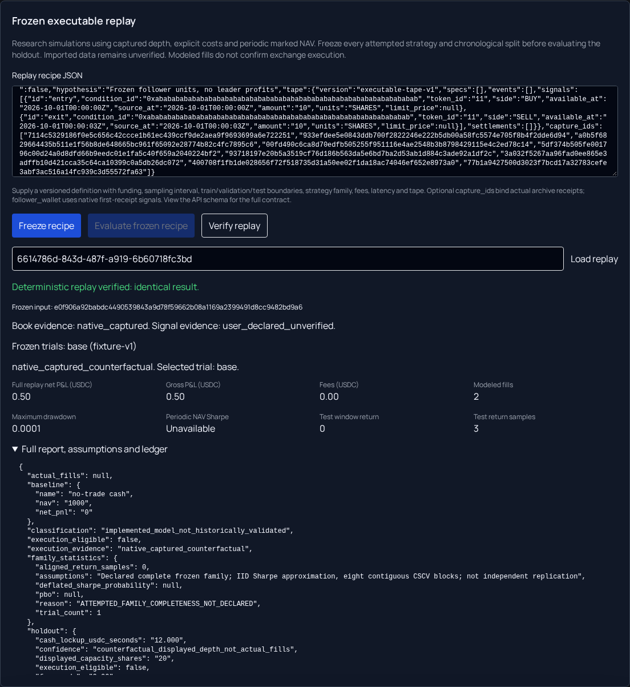

# Executable replay (#55)

Open **Backtesting → Frozen executable replay**. This is a research model built on
the shared native book reconstruction and exact paper ledger. It does not place
orders, prove historical fills, or grant live-trading permission.

## Run and verify

1. Copy the [complete example recipe](executable-replay-example.json) into **Replay
   recipe JSON**. It is an explicitly synthetic imported demonstration: two
   next-receipt IOC fills produce $0.50 before costs. It is not market evidence.
2. Replace the example with your strategy version, hypothesis, entire attempted
   parameter family, dates, funding, costs, decision latency and sampling interval.
   All dates require timezones. Train, validation and test boundaries must lie on
   the sampling grid. `GET /api/backtesting/executable/schema` publishes the typed
   contract. Every attempted trial must be declared before evaluating a winner.
3. For native evidence, add top-level `capture_ids` containing the actual archive
   receipt IDs for metadata, books and status events. The server replaces imported
   market/book/settlement claims with those captured receipts and pins the source
   manifest. Collection is forward-only: new quotes cannot backfill old history.
   Add `follower_wallet` to select its native first-receipt trade signals in the
   window. Otherwise signals remain user-declared and unverified, even with native
   books. Leader profit fields are never used as follower profit.
4. Choose **Freeze recipe**, inspect its hash, evidence labels and complete trial
   family, then **Evaluate frozen recipe**. Evaluation is idempotent. Editing the
   text afterwards does not change the frozen run; freeze a new run explicitly.
5. Read the gross/net costs, modeled fill count and drawdown. Expand **Full report,
   assumptions and ledger** for individual partial/missed fills, cancellations,
   settlement, periodic NAV, split statistics, capacity, spread/slippage, cash
   lockup and market/no-trade baselines.
6. Save the replay ID. **Load replay** retrieves it for the selected account;
   **Verify replay** checks the pinned evidence and recomputes an identical result.
   Missing or modified receipts, recipes or stored results fail verification.

*Real browser → API → database flow using a controlled native provider fixture.
The signals are user-declared; the $0.50 displayed outcome is synthetic and modeled.
The short sample correctly leaves Sharpe unavailable.*

## Execution and accounting assumptions

The fixed `ioc-next-receipt-conservative-depth-v1` policy takes the first eligible
receipt strictly after the decision, with a source state after the decision and
at or beyond the configured latency. Invalid first eligible evidence produces a
miss; the model does not shop for a later favorable quote. Limit price, tick,
lot, minimum size, funding, inventory and displayed depth constrain fills. Unfilled
IOC remainders cancel; an end-of-window position is never forcibly closed.
Price-only indicator backtests remain indicative and cannot supply these fills.

Fees are an explicit flat percentage of traded notional, versioned per trial;
unknown costs abstain. Settlement fees apply to payout. Adverse slippage moves
prices against the trader and rounds adversely to ticks. Gross P&L adds the
modeled fees/slippage back to the matched-quantity net result; it retains the
bid/ask spread and is not an independently rerun frictionless strategy.

The model never assumes replenishment of previously consumed displayed size at
the same condition/token/rule/side/price during a replay. This conservative budget
can understate capacity. It does not model endogenous liquidity, impact, maker
queues or fill probability. #34 owns resting-order lifecycle evidence.

Cash, shares, basis, fees and realized outcomes use the shared Decimal ledger.
Fresh captured exit bids provide indicative marks. Missing/stale books or an
unresolved/disputed/expired held token make NAV unavailable. Confirmed payouts
release capital only when the actual captured receipt becomes available. Native
finalization requires matching binary CLOB/Gamma outcomes and winners; unsupported
void evidence stays disputed. Explicit imported void payouts remain unverified
claims. Conflicting later finals freeze valuation and new fills for reconciliation.

## Statistics and research discipline

NAV is sampled on the frozen regular grid, including interval boundaries. Returns
are adjacent marked NAV changes with zero risk-free return. The default year is
365 days (`31,536,000 / sample_seconds` periods); a declared override is hashed
into the recipe. Missing intervals are not silently removed. Sharpe needs at least
30 complete, nonconstant periodic returns. Trade-P&L Sharpe is never supplied.

The full attempted family is frozen first. Validation marked NAV return chooses
the winner, with frozen family order breaking ties; only that policy is evaluated
through the test window. `splits.test` is the out-of-sample report. No valid
validation NAV means no selected winner or test result. The application cannot
prove that an operator has never seen the holdout elsewhere; this is a declared
chronological holdout, not an independently blinded experiment.

Confidence intervals use 200 seeded IID bootstrap resamples of periodic mean
return (95% descriptive interval), with sample counts and IID assumptions. They
are not evidence of profitability under serial dependence. Family deflated-Sharpe
probability requires a declared complete family, two comparable nonconstant
aligned series and 30 validation returns. Identical return series do not count
as distinct trials; their family diagnostics remain unavailable. It evaluates the family's highest
per-period validation Sharpe, separately from the NAV-return winner. PBO requires
eight trials, 80 aligned validation returns and all 70 eight-block CSCV partitions;
trailing unpartitioned samples are reported. Unavailable diagnostics remain null
with reasons. Floating point is limited to statistical summaries; money remains
exact Decimal in the authoritative report.

## Operator setup and rollback

This change depends on #97's paper-account migration, #101's maker lifecycle
migration, and the native archive/book work. Apply `20261027_0037_executable_replay`, then explicitly enable
`EXECUTABLE_REPLAY_ENABLED=true` (default false). Capturing new native evidence also
requires `NATIVE_CAPTURE_ENABLED` and `OBSERVATION_ARCHIVE_ENABLED`; existing archive
capture/subscription controls still apply. No TradingView feed is used. Operators
remain responsible for permission to reuse the selected native source data.

Runs are private to user and account; captured source receipts are shared public
evidence, not shared hypotheses or fee settings. Freeze/evaluate/recompute are
rate limited to two per minute per client. A frozen run cannot be deleted through
the legacy backtest endpoint. Source membership pins prevent retention from
silently deleting referenced evidence.

Turn the replay flag off to disable the API. Export private runs before downgrading
0037: downgrade drops its two research tables, preserving legacy backtests, paper
accounts and public datasets. Migration 0037 follows maker lifecycle migration
0036; apply #97, then #101, then this change. The combined graph has one head. Existing risk controls and the server-owned live-trading release barrier
remain authoritative.

The synchronous model is bounded to one year, eight trials, 250 events, 100 signals,
50 settlements, 5,000 depth cells and 2,000 NAV samples, plus a sampling/event/trial
work budget of 250,000. These limits bound replay cost; they are not a claim of
complete historical venue coverage.

## Acceptance evidence

| Requirement | Validation |
| --- | --- |
| Next-receipt depth, latency, tick/lot, partial/nonfill, no final forced sale | Kernel fixtures and shared #18 depth walker; real native HTTP → SQLite → API → browser E2E. |
| Fees/slippage reverse profit; cancellation/settlement/basis reconcile | Golden $0.50 gross / -$0.35 net at 1,000 bps; adverse slippage, partial IOC, explicit void, payout fee and later final-conflict regressions. |
| Periodic NAV, follower reconstruction, no leader P&L | Regular-grid sample/CI/Sharpe tests, missing-NAV tests, legacy leader-loss regressions, account-scoped source query. |
| Provenance, frozen family, chronological holdout | Recipe/source/result hashes; pinned native receipts and signal payload validation; future holdout changes cannot select the winner. |
| Missing history, expiry, delayed resolution, corruption | Missing book, unresolved expiry, disputed/void/final conflicts, reused-depth and token-swap fixtures; no numeric NAV when evidence is missing. |
| Diagnostics and output | Sample counts, unavailable reasons, eligible DSR/PBO fixtures, deterministic replay; full ledger/capacity/costs/lockup/baseline/split report. |
| Persistence and isolation | Real SQL API owner/account/tamper tests; PostgreSQL concurrent execution produces one cached result, process-exit rollback, additive migration preservation. |
| Compatibility and live barrier | Existing backtesting regression suite, frontend build, SDK create/post/cancel blocked in browser fixture; no production money-path imports. |

Run `npm run test:executable` from `frontend` to reproduce the browser test and
screenshot. PostgreSQL tests require `TEST_DATABASE_URL` pointing at a disposable
test database. CI runs both paths.
