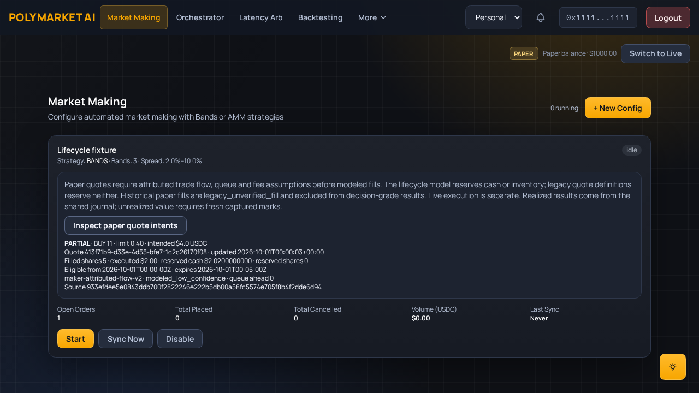

# Paper maker lifecycle

Open **Market Making**, then select **Inspect paper quote intents** on a config.
The lifecycle view separates intended notional, executed notional, filled shares,
reserved cash/shares, eligibility and expiry clocks, source receipts and model
confidence. Paper values are modeled, never exchange-confirmed executions.

The screenshot uses a controlled attributed-flow fixture, not a native live fill.
A ten-share bid at 0.40 with three shares assumed ahead and eight eligible shares
of sell-aggressor flow fills five shares. With a 100-bps fee assumption, cash goes
from 1,000 to 997.98 and the remaining reservation is 2.02. Duplicate delivery
changes neither cash nor shares. Cancellation releases the remainder.

## What produces a fill

A generated band creates a resting quote, not a trade. An unchanged market over
100 syncs produces zero fills and retains each active quote ID. Repricing creates
new IDs and requests cancellation of the old quote. Configured cancellation latency
keeps reservations until cancellation is effective; flow before that boundary can
produce a partial fill. Stops and invalid/gapped data conservatively cancel/release
eligibility immediately. Terminal orders are never resurrected.

A modeled fill requires all of the following:

- Correct condition, token, opposing aggressor side and a price touching the limit.
- Source occurrence and receipt after quote eligibility, including decision/network
  latency, and before expiry/cancellation; fresh source clocks and continuity.
- Explicit queue-ahead and fee assumptions. Unknown fees never become zero fees.
- Observed traded volume remaining after queue depletion, shared across every
  maker config in the account. Cash, inventory and config collateral constraints
  must also hold. A midpoint touch alone never produces a fill.

**Native `last_trade_price.side` is not verified aggressor attribution.** Its archive
contract explicitly marks that uncertainty; the native adapter abstains. The
positive fill/retry examples use controlled, explicitly attributed fixtures.
Do not change the native adapter's capability flag to make paper results look
active. Independent source-contract validation is required before promotion.

## Cash, results and historical data

The shared #27 journal reserves capital at quote acceptance and books cash,
shares and fees only for accepted modeled fill events. Account locks, unique
order/event/sequence identities and a single transaction protect retries, races
and crash rollback. No separate maker cash balance exists.

Realized P&L and cost-adjusted spread capture use the shared ledger's cost basis
for the token inventory; they are not evidence of maker alpha. Fees are reported
separately. Unrealized P&L belongs to shared account NAV with fresh captured exit
marks, rather than an invented independently owned maker inventory.

Existing simulated maker trades remain unchanged. A bounded sidecar classifier
marks them `legacy_unverified_fill`; journal-backed results exclude them. The
historical counters remain visible as unverified paper counters. Sidecar backfill
processes up to 500 rows per sync and can be repeated without modifying originals.

Indicative midpoint markouts are frozen at 5, 30 and 60 seconds after a fill.
Missing, stale or pre-fill evidence produces an unavailable markout. Late source
backfills cannot revise a frozen result. Markouts are not realized profit or
causal price impact. The per-sync markout budget is 20 recent fills; independent
production throughput/calibration has not been established.

## Enable and roll back

This change depends on the pending shared-journal PR #97 and the merged #98/#99
archive/book foundation. Use the integrated migration chain, with one head:
`20261027_0036_maker_lifecycle`. Apply migrations before enabling workers.

Enable `PAPER_JOURNAL_V2_ENABLED`, `OBSERVATION_ARCHIVE_ENABLED`,
`BINARY_BOOK_RESEARCH_ENABLED` and `PAPER_MAKER_FILL_MODEL_V2`. Native collection
also uses `NATIVE_CAPTURE_ENABLED` and configured archive token subscriptions.
Configure explicit account fees/funding and acknowledge exclusion of legacy history
through **Paper account controls**. Optional bounded settings are
`PAPER_MAKER_LATENCY_MS` (default 0), `PAPER_MAKER_EXPIRY_SECONDS` (default 300),
and `PAPER_MAKER_QUEUE_AHEAD` (default unknown). Explicit zero queue is an
assumption, not an observed position in the exchange queue.

For rollback, stop configs first so reservations are released, verify the shared
journal balances, then disable the lifecycle flag and restart workers. The prior
no-evidence/no-fill intent path remains available. Keep the journal and audit
tables for replay; export evidence before any schema downgrade. Never downgrade
an active account's reservation history. The bounded source replay budget is
10,000 receipts per active window; overflow rejects the sync for reconciliation.

## Acceptance evidence

| #34 acceptance | Regression evidence |
| --- | --- |
| 10/100 stationary syncs produce no fills or duplicate IDs | Existing intent test, pure replay and durable runtime hundred-cycle tests; browser starts from 100 real SQL syncs. |
| Untouched/no attribution/unknown queue stays unfilled | Wrong side/token/price and missing assumptions fixtures; native trade-side abstention. |
| Precision, tick, availability, latency, min size and queue | Pure boundary sweep and runtime validation/reservation tests. |
| Volume budget, partial/cancel/fill race and inventory | Multi-quote and multi-config print-budget tests; ledger conservation, cancellation deadline and no-short inventory checks. |
| Missing/stale/gapped source cannot imply success | Native unknown continuity, pure gap/reorder/expiry cases and stale/invalid-book cancellation. |
| Duplicates/reordering/restart book once | Serialized replay tests; real SQL retry; PostgreSQL competing workers and hard process-exit rollback. |
| Legacy not decision-grade, originals preserved | Sidecar classifier regression and journal-only valuation; explicit API/UI quality label. |
| No signer/post/approval/cancel path in paper | Both SDK mutation boundaries fenced in tests and E2E; existing live policy/gateway regression suite. |
| PostgreSQL, API, UI and E2E | New maker PG integration and real HTTP/SQL/UI lifecycle/isolation browser tests, wired into CI. |

Synthetic shadow baseline: `maker-shadow-baseline.json`. No observed exchange-fill
calibration or profitability claim is made. Live authorization and risk gates are
unchanged; enabling this flag cannot authorize a live order.
